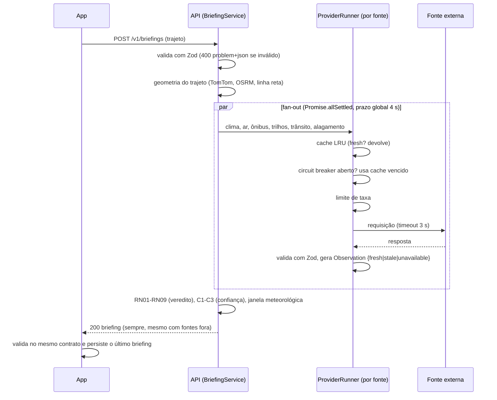

# Καιρός

Aplicativo Android que ajuda a decidir se vale sair agora ou esperar em deslocamentos na cidade de São Paulo. Para cada trajeto cadastrado (origem, destino, linhas de ônibus e de trilhos), o app consulta um backend próprio que reúne em paralelo clima, qualidade do ar, previsão de chegada dos ônibus, situação das linhas de Metrô e trens, trânsito no trajeto e pontos históricos de alagamento.

O resultado é um briefing com veredito (Favorável, Atenção, Aguardar ou Indeterminado), motivos, melhor janela meteorológica nas próximas 6 h, nível de confiança e, para cada dado, a fonte, o horário da observação e o estado (`fresh`, `stale` ou `unavailable`).

*Kairós* (καιρός) é o "momento oportuno" em grego.

> **Contexto acadêmico:** O Καιρός se trata da atividade prática supervisionada (APS) da disciplina de Sistemas Distribuídos. Ele NÃO é um produto comercial, NÃO tem suporte NEM garantia de funcionamento. Os alertas são orientativos e não substituem a Defesa Civil (199), os Bombeiros (193) quanto menos os avisos do INMET. O escopo se limita à cidade de São Paulo e a fontes gratuitas, sem necessidade de cadastrar cartão de crédito/débito para usufruir dos serviços.

**Demonstração:** [Assista ao vídeo no YouTube](https://youtu.be/3u-hWAqDQU4)

**Integrantes:** Guilherme Guedes, Gustavo Nascimento, Pablo Kayky e Victor Ribeiro.

**Stack:** React Native com Expo (SDK 57), Node.js 24 com Fastify 5, PostgreSQL com PostGIS, tudo em TypeScript. O contrato entre app e API é definido com Zod.

**Licença.** O código está sob licença MIT ([`LICENSE`](LICENSE)). Os dados não são cobertos por ela: cada fonte tem licença e termos próprios, e algumas restringem o uso comercial (ARTESP em CC BY-NC 4.0, Open-Meteo gratuita apenas para uso não comercial e TomTom em plano gratuito proprietário). Qualquer uso fora do contexto acadêmico exige rever todas elas. Detalhes em [Licenças e créditos dos dados](#licenças-e-créditos-dos-dados).

---

## Sumário

1. [Visão geral](#1-visão-geral)
2. [Como executar](#2-como-executar)
3. [Arquitetura](#3-arquitetura)
4. [Requisitos e regras de negócio](#4-requisitos-e-regras-de-negócio)
5. [Testes e resultados medidos](#5-testes-e-resultados-medidos)
6. [Decisões de arquitetura](#6-decisões-de-arquitetura)
7. [Fontes de dados](#7-fontes-de-dados)
8. [Estrutura do código e convenções](#8-estrutura-do-código-e-convenções)
9. [Limitações e trabalho futuro](#9-limitações-e-trabalho-futuro)
10. [Licenças e créditos dos dados](#licenças-e-créditos-dos-dados)

---

## 1. Visão geral

### 1.1 Problema e objetivos

Quem se desloca em São Paulo consulta separadamente previsão do tempo, qualidade do ar, ônibus, Metrô/trem e risco de alagamento. Cada provedor atualiza em ritmo próprio e tem confiabilidade diferente, e o usuário precisa cruzar essas informações manualmente para decidir se sai ou espera. O projeto propõe uma aplicação móvel distribuída que agrega essas observações para um trajeto cadastrado e devolve uma recomendação justificada, com fonte, recência e confiança de cada dado, mantendo-se funcional quando parte das fontes falha.

O público-alvo são pessoas que fazem deslocamentos recorrentes de transporte público (por exemplo, casa e faculdade ou trabalho).

| ID | Objetivo específico |
|---|---|
| OE1 | Integrar ao menos 6 fontes externas independentes por meio de adaptadores |
| OE2 | Gerar o briefing com veredito, motivos, recência e confiança por regras explícitas |
| OE3 | Responder parcialmente quando uma fonte falhar, atrasar ou devolver dado inválido |
| OE4 | Respeitar os limites de taxa das fontes com cache e TTL |
| OE5 | Cruzar o trajeto com áreas históricas de alagamento por consulta espacial (PostGIS) |
| OE6 | Entregar um `.apk` instalável e um roteiro de demonstração reprodutível, com cenários de falha |

### 1.2 Telas

| Aba | Conteúdo |
|---|---|
| Trajetos | "Tempo agora" (temperatura, sensação, chance de chuva, vento, umidade, UV, nascer e pôr do sol, próximas horas), veredito do trajeto principal e lista de trajetos. Favoritos ficam no topo; os demais são ordenados por frequência de uso ponderada por recência e horário, calculada só no aparelho |
| Briefing | Veredito com ação e motivo, melhor horário, "O que fazer agora", atrasos e obstáculos, uma seção por dimensão (ônibus, trilhos, trânsito, clima, ar, alagamento) indicando se ela pesa no veredito, fontes com falha explicadas em linguagem comum, aviso "Desatualizado" sem rede, compartilhamento como texto e atalhos para Uber e 99 quando o veredito é Aguardar |
| Alertas | Alertas de nível 0 a 3 calculados a partir do último briefing e do tempo agora, com as referências públicas usadas (AMS, CONAMA/MMA, OMS, Defesa Civil de SP, INMET) e botões que abrem o discador para 199 e 193 |
| Mapa | Leaflet com OpenStreetMap: posição do usuário, rota a pé até a origem, rota de carro da origem ao destino, distâncias, traçado do último briefing com faixa de 300 m e camadas de alagamento, chuva, temperatura e trânsito ao vivo |
| Sobre | Explicação do sistema distribuído com dados ao vivo (nós, estado, latência), estado das fontes, endereço do servidor da API, registro de requisições do aparelho, relatório agregado do servidor, lembretes de saída, tema claro/escuro e atribuições |

Sem conexão com a API, o app mostra o último briefing salvo com o aviso "Desatualizado há N min".

---

## 2. Como executar

O roteiro abaixo roda tudo localmente: o backend em Docker no PC e o app em um celular Android na mesma rede Wi-Fi. Nada é hospedado na nuvem.

### 2.1 Pré-requisitos

| Item | Uso | Obrigatório |
|---|---|---|
| Docker Desktop (no Windows, com WSL 2) | Banco (PostGIS) e API | Sim |
| Git | Clonar o repositório | Sim (ou baixar o ZIP) |
| Node.js 24 (inclui o npm) | Importar os pontos de alagamento e executar o app pelo Expo Go | Só para esses dois casos |
| Celular Android na mesma rede do PC | Executar o app | Sim |
| Chaves gratuitas (SPTrans, TomTom, ARTESP) | Ônibus, trânsito e rotas, linhas 6 a 9 | Não (ver [2.9](#29-funcionamento-sem-chaves)) |

O projeto foi desenvolvido e testado em um PC Windows com Docker Desktop e em um celular com Android 12. Os comandos usam PowerShell; no macOS e no Linux, troque `Copy-Item` por `cp`.

### 2.2 Clonar e configurar o `.env`

```powershell
git clone https://github.com/mfr-vic/APS-Kairos kairos
cd kairos
Copy-Item .env.example .env
```

O `.env` fica só no PC (está no `.gitignore`) e nunca vai para o app.

| Variável | Função | Se ficar vazia |
|---|---|---|
| `DB_PASSWORD` | Senha do PostgreSQL. Defina antes do primeiro `docker compose up`, pois o banco grava a senha ao criar o volume | Senha padrão pública `kairos-dev-123` |
| `DB_PORT`, `API_PORT` | Portas expostas no PC | 5432 e 3000 |
| `NODE_ENV`, `LOG_LEVEL` | Ambiente e nível de log | Padrões |
| `SPTRANS_TOKEN` | Olho Vivo (ônibus) | Ônibus `unavailable`; a API sobe normalmente |
| `TOMTOM_KEY` | Rotas de carro e a pé, trânsito ao vivo | Rota de carro pelo OSRM, sem trânsito e sem rota a pé |
| `ARTESP_KEY` | API Trilhos (linhas 4 a 9) | Linhas 6 a 9 ausentes; 4 e 5 vêm da página do Metrô |
| `OSRM_BASE_URL`, `NOMINATIM_BASE_URL` | Servidores próprios | Servidores públicos (≤ 1 req/s, User-Agent próprio) |
| `DEMO_MODE`, `DEMO_TOKEN` | Modo demonstração ([2.11](#211-modo-demonstração)) | Modo desligado |
| `HISTORICO_SEGREDO` | Segredo do HMAC que torna o trajeto irreversível no histórico (RF26, RNF14); use 32 ou mais caracteres aleatórios | Segredo aleatório a cada boot |
| `CACHE_PASSWORD`, `CACHE_PORT`, `API_CACHE_URL`, `CACHE_URL` | Perfil opcional `sd-avancado` ([2.12](#212-perfil-opcional-sd-avancado)) | Cache LRU em memória |

Credenciais ficam só no `.env` do backend. Variáveis `EXPO_PUBLIC_*` entram no bundle do app e nunca devem guardar chaves.

### 2.3 Subir o backend

```powershell
docker compose up -d --build
docker compose ps            # kairos-db deve ficar healthy e kairos-api Up
```

São dois containers: `db` (PostGIS 16-3.4, com as tabelas `flood_points`, `dataset_imports` e `briefing_log` criadas por `apps/api/database/init.sql`) e `api` (Fastify na porta 3000). Depois de um `--build`, a API leva de 1 a 3 minutos para responder bem, porque aquece as conexões com as fontes no boot.

```powershell
curl.exe http://localhost:3000/v1/health
curl.exe http://localhost:3000/v1/health/providers
```

### 2.4 Importar os pontos de alagamento

A imagem da API não inclui os scripts de banco. A importação roda no PC (Node 24), contra o banco exposto em `127.0.0.1:5432`, lendo o mesmo `.env`:

```powershell
npm install
npm run db:import-geosampa -w apps/api
```

O script aplica as migrations pendentes (`apps/api/database/migrations/001` a `004`; também há `npm run db:migrate -w apps/api`), baixa a camada `risco_ocorrencia_alagamento` do WFS do GeoSampa (292 pontos de 2026, conferidos em 10/10/2026), converte de EPSG:31983 para 4326 no PostGIS e registra o SHA-256 do conteúdo. É idempotente (RF20, TC11): se o conteúdo não mudou, nada é alterado. Sem a importação a API funciona, mas a dimensão de alagamento nunca encontra pontos próximos.

> O npm 12 bloqueia scripts de instalação fora da lista `allowScripts` do `package.json` da raiz. Se aparecer "install scripts blocked", rode `npm install-scripts ls`, leia o script e aprove com `npm install-scripts approve <pacote>`.

### 2.5 Liberar o PC na rede local

1. Descubra o IP do PC com `ipconfig` (endereço IPv4 do adaptador Wi-Fi, por exemplo `192.168.1.20`).
2. Marque a rede como Privada, pois o Windows bloqueia conexões de entrada em redes Públicas: `Set-NetConnectionProfile -InterfaceAlias "Wi-Fi" -NetworkCategory Private` (PowerShell como administrador).
3. Libere a porta 3000 no firewall:
   ```powershell
   New-NetFirewallRule -DisplayName "Kairos API 3000" -Direction Inbound -Protocol TCP -LocalPort 3000 -Action Allow -Profile Private
   ```
4. No navegador do celular, abra `http://<IP-do-PC>:3000/v1/health`. Deve aparecer `{"status":"up",...}`.

Redes de faculdade e de empresa costumam isolar os aparelhos entre si. Nesse caso, use o hotspot do celular ou um roteador próprio.

### 2.6 Instalar o `.apk`

Baixe o `kairos.apk` na página de [Releases](https://github.com/mfr-vic/APS-Kairos/releases/latest), abra o arquivo no celular e permita a instalação de apps desconhecidos se o Android pedir.

### 2.7 Apontar o app para o seu PC

O `.apk` sai do build com o endereço da máquina de desenvolvimento do grupo. Ajuste no app:

1. Abra Sobre, depois "Estado das fontes", seção "Servidor da API".
2. Digite o endereço do PC com a porta (por exemplo `192.168.1.20:3000`).
3. Toque em "Testar conexão" e, se funcionar, em "Salvar".

### 2.8 Alternativa: Expo Go

Requer Node 24 no PC e o Expo Go (compatível com o SDK 57) no celular.

```powershell
npm install
npm run build                       # compila packages/contracts (o app importa o dist) e a API
```

Crie `apps/mobile/.env` com `EXPO_PUBLIC_API_URL=http://192.168.1.20:3000` e execute:

```powershell
npm run dev -w apps/mobile          # expo start --lan; escaneie o QR code com o Expo Go
```

O Metro também precisa ser alcançável pelo celular: permita o Node.js na rede Privada ou libere a porta 8081. No Expo Go do Android os lembretes de saída (RF25) não funcionam, porque o `expo-notifications` não carrega ali (SDK 53 ou superior), e o app oculta a função. No `.apk` eles funcionam.

### 2.9 Funcionamento sem chaves

| Configuração | Funciona | Fica de fora |
|---|---|---|
| Nenhuma chave | Clima e "tempo agora" (Open-Meteo), ar (CAMS), alagamento (GeoSampa no PostGIS, após [2.4](#24-importar-os-pontos-de-alagamento)), busca de endereço (Nominatim), rota de carro de reserva (OSRM), linhas 1, 2, 3, 4, 5 e 15 pela página "Direto do Metrô" | Ônibus, trânsito, rota a pé, linhas 6 a 9 |
| Sem `TOMTOM_KEY` | Rota de carro pelo OSRM | Dimensão `traffic` (`unavailable`), camada de trânsito e rota a pé. Trajetos com ônibus ficam no máximo com confiança MÉDIA (RN09) |
| Sem `SPTRANS_TOKEN` | Todo o resto | Busca de linhas e paradas e previsão de chegada |
| Sem `ARTESP_KEY` | Linhas 4 e 5 pela página do Metrô | Linhas 6 a 9 (ver [4.6](#46-fora-do-escopo-e-limitações-de-cobertura)) |
| Modo demonstração | Todos os cenários simulados, sem nenhuma chave | Exige `DEMO_MODE=true` e algum valor em `DEMO_TOKEN` |

### 2.10 Como obter as chaves

Todas são gratuitas e não pedem cartão.

| Chave | Onde | Observações |
|---|---|---|
| `SPTRANS_TOKEN` | <https://www.sptrans.com.br/desenvolvedores/> | Cadastro de desenvolvedor e criação de um aplicativo para receber o token do Olho Vivo |
| `TOMTOM_KEY` | <https://developer.tomtom.com/> | Copie o valor completo da chave; um valor truncado resulta em 403 |
| `ARTESP_KEY` | <https://ccm.artesp.sp.gov.br/metroferroviario/api/docs/> | Aprovação manual (pode levar dias). Limite de 12 requisições por hora por credencial. Dados CC BY-NC 4.0 |

### 2.11 Modo demonstração

O modo demonstração substitui as fontes reais por provedores simulados com cenários nomeados, o que permite mostrar regras e falhas de forma reprodutível (RF19). Os dados simulados saem marcados como `simulado:<fonte>` e têm cache, circuit breaker e saúde separados dos reais.

1. No `.env`, defina `DEMO_MODE=true` e `DEMO_TOKEN` (de preferência com 32 ou mais caracteres aleatórios). Com `DEMO_MODE=true` e sem token, a API se recusa a subir.
2. Recrie a API: `docker compose up -d api`.
3. Liste e ative cenários (o cabeçalho `X-Demo-Token` é obrigatório):

```powershell
curl.exe -H "X-Demo-Token: SEU_TOKEN" http://localhost:3000/v1/demo/scenario
curl.exe -X POST -H "X-Demo-Token: SEU_TOKEN" -H "Content-Type: application/json" `
  -d '{\"cenario\":\"chuva-forte\"}' http://localhost:3000/v1/demo/scenario
```

4. Peça o briefing no app (deslize a tela para baixo para atualizar). Para voltar às fontes reais, ative `real`.

A rota responde 404 com o modo desligado, 401 sem token, 403 com token errado e 400 com nome de cenário inválido. O cenário vale para todos os briefings enquanto estiver ativo.

Resultados esperados para o trajeto de referência (ônibus 875A-10 e Linha 1), conferidos por teste. Em trajetos sem ônibus ou sem trilhos, os cenários dessas dimensões não têm efeito.

| Cenário | Simulação | Resultado esperado |
|---|---|---|
| `real` | Nenhuma | Fontes reais |
| `normal` | Tudo tranquilo | FAVORÁVEL, confiança ALTA |
| `chuva-forte` | 12 mm/h na próxima hora | AGUARDAR (RN01) |
| `chuva-moderada` | 5 mm/h | ATENÇÃO (RN02) |
| `alagamento` | 4 mm/h e pontos a 120 m e 260 m | AGUARDAR (RN03 e RN02) |
| `ar-ruim` | MP2,5 médio de 24 h = 62 µg/m³ | ATENÇÃO (RN05) |
| `onibus-demorado` | Próximo ônibus em 35 min | ATENÇÃO (RN07) |
| `trilho-paralisado` | Primeira linha do trajeto paralisada | AGUARDAR (RN06) |
| `trilho-intervalos` | "Maiores Intervalos" com explicação da operadora | ATENÇÃO (RN06) |
| `transito-intenso` | 10 min de atraso sobre 14 min livres | ATENÇÃO (RN09, com ônibus) |
| `sptrans-fora` | Olho Vivo com HTTP 503 | FAVORÁVEL, MÉDIA, ônibus `unavailable` (TC12) |
| `dados-obsoletos` | Clima de 30 min e ônibus de 1 min atrás | FAVORÁVEL, MÉDIA, clima e ônibus `stale` (TC15) |
| `resposta-invalida` | Clima sem campo obrigatório, ar com JSON malformado | FAVORÁVEL, BAIXA, os dois `unavailable` (TC14) |
| `clima-lento` | Clima responde após 10 s | FAVORÁVEL, BAIXA, clima `unavailable` pelo timeout de 3 s (TC13) |
| `tudo-fora` | Todas as fontes fora | INDETERMINADO, BAIXA (RN08) |

O catálogo está em `apps/api/src/modules/demo/cenarios.ts` e os provedores simulados em `apps/api/src/providers/simulated/`.

### 2.12 Perfil opcional `sd-avancado`

Demonstra um cache compartilhado entre processos (RF27, ADR 06): um container Valkey e um worker separado que mantém quentes as chaves de clima, ar, Metrô e alagamento. O worker não tem credenciais e nunca chama ARTESP, Olho Vivo, TomTom, OSRM nem Nominatim.

```powershell
docker compose --profile sd-avancado up -d --build cache worker
# no .env: API_CACHE_URL=redis://cache:6379
docker compose up -d api
```

Se o Valkey cair, a API volta sozinha ao LRU em memória. Fora do Docker (`npm run dev`), use `CACHE_URL=redis://127.0.0.1:6379`.

### 2.13 Problemas comuns

- **O celular não abre `/v1/health`.** Causas habituais: rede marcada como Pública, porta 3000 bloqueada, IP errado (ele muda com DHCP) ou rede que isola aparelhos. Teste primeiro no navegador do celular.
- **Briefing INDETERMINADO ou com tudo `unavailable` logo após subir.** A API ainda está aquecendo (as primeiras conexões chegaram a 31 s em 13/10/2026). Aguarde de 1 a 3 minutos.
- **Fontes excedendo o tempo limite com a máquina sobrecarregada.** Com testes, Expo, navegador e Docker em execução ao mesmo tempo, as fontes ultrapassam 3 s e o circuit breaker abre por 60 s. Evite builds e testes durante uma demonstração.
- **Docker Desktop sem resposta** (`docker info` não retorna e os testes de integração são pulados sem aviso). Feche o Docker Desktop, rode `wsl --shutdown`, reabra, espere o engine (cerca de 2 min), suba `docker compose up -d db`, aguarde `healthy` e rode `docker compose up -d api`.
- **`db` unhealthy após fechamento abrupto do Docker.** O PostgreSQL está se recuperando. Aguarde alguns minutos e rode `docker compose up -d api`.
- **Erro de senha do banco na importação.** O `DB_PASSWORD` mudou depois da criação do volume. Volte ao valor antigo ou recrie o banco com `docker compose down -v` (apaga os dados) e importe de novo.
- **Linhas 4 a 9 sem dados da ARTESP.** O orçamento é de 12 chamadas por hora por credencial, e cada boot da API gasta uma no aquecimento. A API se limita a 10 por hora e respeita o `Retry-After` do 429. Não reinicie a API em laço nem repita `apps/api/scripts/verificar-artesp.ts`.
- **TomTom 403.** Chave copiada truncada.
- **`.apk` instalado sem conexão com a API.** Confira o "Servidor da API" ([2.7](#27-apontar-o-app-para-o-seu-pc)). O `.apk` libera HTTP sem TLS para a rede local (`usesCleartextTraffic`).
- **A versão web (`expo start --web`) não consegue chamar a API.** A API não envia cabeçalhos CORS, e o app nativo não precisa deles.

### 2.14 Desenvolvimento, testes e build do `.apk`

```powershell
npm run dev                          # API local com recarga (lê o .env da raiz; banco em 127.0.0.1)
npm run build                        # contrato e API
docker compose up -d db              # os testes de integração do PostGIS são pulados sem o banco
npm test                             # contracts e API (Vitest) e app (Jest)
npm run test:coverage -w apps/api    # cobertura da API
npm run lint
npm run typecheck
```

Na suíte completa da raiz, um arquivo ocasional pode exceder o tempo limite por sobrecarga da máquina. Nesse caso, rode o pacote isoladamente para confirmar o resultado.

O `.apk` é gerado pelo EAS Build com o perfil `preview` de `apps/mobile/eas.json` (Node 24.21.0). Use uma conta Expo própria: execute `npx eas-cli login`, remova o `extra.eas.projectId` do `app.json` (que pertence ao grupo), rode `npx eas-cli init` em `apps/mobile` e então `npx eas-cli build --platform android --profile preview`. O gancho `eas-build-post-install` compila `packages/contracts` no servidor de build, porque o `dist` não vai no upload. Antes de cada build, inspecione o pacote enviado (`eas build:inspect --stage archive`) para garantir que não há `.env` nem chaves; depois, descompacte o `.apk` e procure os valores do `.env` (TC25). O perfil `production` (AAB para loja) existe, mas só faz sentido com uma API pública.

---

## 3. Arquitetura

### 3.1 Por que é um sistema distribuído

- **Componentes autônomos em máquinas diferentes:** celular, PC (API e banco em containers) e sete serviços externos de organizações distintas.
- **Comunicação só por mensagens:** HTTP/JSON. Nenhum componente acessa a memória de outro.
- **Falhas parciais e independentes:** a queda de uma fonte não derruba o briefing (RF15).
- **Sem relógio nem estado globais:** cada observação carrega seu carimbo de tempo, e o sistema raciocina sobre recência (RF12, RF13). A consistência fraca ou eventual é assumida explicitamente.
- **Transparência:** o app não sabe quantas fontes existem, onde estão nem como falham.
- **Concorrência:** as consultas de um briefing rodam em paralelo, com prazo global.

### 3.2 Componentes


| Componente | Responsabilidade | Depende de |
|---|---|---|
| App | Cadastro e armazenamento local de trajetos, chamada à API, exibição, cache offline | API, `contracts` |
| `packages/contracts` | Schemas Zod e tipos compartilhados por app e API | Nenhum |
| BriefingService | Orquestração, prazo global, composição dos trilhos, montagem da resposta | Adaptadores, regras, FloodRisk, cache |
| Adaptadores de provedor | Chamar a fonte, validar, normalizar no envelope, mapear erros | Cliente HTTP, CachePort, CircuitBreaker |
| Regras, Confiança e Janela | Funções puras com `agora` explícito (RN01 a RN09, C1 a C3, janela) | `contracts` |
| FloodRiskService | `ST_DWithin` entre a geometria do trajeto e os pontos | PostGIS |
| RouteGeometryService | TomTom (com chave), depois OSRM, depois linha reta (esta só para o raio de alagamento, nunca exibida); nunca lança exceção | Adaptadores TomTom e OSRM, cache |
| CachePort | `get`, `set` com TTL e `getStale` | LRU em memória ou Valkey |
| Demo | Troca os adaptadores reais pelos simulados conforme o cenário, por requisição | Adaptadores simulados |

### 3.3 Fluxo de um briefing



Cada fonte passa pelo mesmo `ProviderRunner` (um por processo da API): cache LRU, circuit breaker, limitador de taxa, timeout, validação Zod e, por fim, uma `Observation` com `source`, `observedAt`, `fetchedAt`, `ttlSeconds`, `status` e, quando `unavailable`, um `motivo` obrigatório.

### 3.4 API (contrato v1)

| Rota | Uso | RF |
|---|---|---|
| `POST /v1/briefings` | Briefing de um trajeto | RF05 |
| `GET /v1/geocode?q=` | Busca de endereço (Nominatim), só ao confirmar, sem autocomplete | RF01 |
| `GET /v1/transit/bus/lines?q=` e `GET /v1/transit/bus/stops?lineCode=` | Linhas e paradas (Olho Vivo) | RF02 |
| `GET /v1/transit/rail/lines` | Linhas de trilho com fonte configurada | RF03 |
| `GET /v1/weather?lat=&lon=` | Clima para o widget "tempo agora" (mesmo cache do briefing; fonte fora devolve `unavailable`, nunca 500) | RF06 |
| `GET /v1/rota?de=lat,lon&para=lat,lon&modo=a-pe\|carro` | Rota real para o mapa (TomTom; `carro` cai para o OSRM). 400 em validação, 503 sem rota, nunca linha reta | RF24 |
| `GET /v1/mapa/transito/{z}/{x}/{y}.png` | Tiles de fluxo de trânsito da TomTom via proxy (a chave fica no servidor); zoom 10 a 18, só a área de SP; 503 sem chave ou cota | RF22 |
| `GET /v1/mapa/camadas` | Pontos de alagamento (PostGIS) e grade de chuva e temperatura (Open-Meteo, 12 regiões); camada fora vira `unavailable` | RF23 |
| `GET /v1/health` e `GET /v1/health/providers` | Liveness e estado por fonte: status, última latência, último sucesso, `requestCount`, `successCount`, `avgLatencyMs` (só chamadas reais à fonte desde o boot) | RF18 |
| `GET /v1/reports/summary` | Vereditos por dia e disponibilidade por provedor | RF26 |
| `GET` e `POST /v1/demo/scenario` | Modo demonstração (`DEMO_MODE=true` e `X-Demo-Token`) | RF19 |

Exemplos validados de requisição e resposta estão em `packages/contracts/examples/`. Os erros seguem o RFC 9457 (`application/problem+json`):

```json
{ "type": "…/validation", "title": "Entrada inválida", "status": 400,
  "detail": "trajeto.origem.lat fora do intervalo", "instance": "/v1/briefings" }
```

No app, respostas 4xx e 5xx viram mensagens em pt-BR a partir do `title`.

### 3.5 Falhas, TTL e limites

TTL (*time to live*) é o tempo em que um dado em cache é considerado atual. O cache LRU descarta primeiro o item menos usado recentemente. A tabela resume o TTL, o timeout e o limite de uso de cada fonte.

| Fonte | TTL | Timeout | Limite respeitado |
|---|---|---|---|
| Open-Meteo clima | 15 min | 3 s | Plano não comercial (< 10 mil chamadas/dia) |
| Open-Meteo ar | 60 min | 3 s | Idem |
| Olho Vivo previsão | 30 s | 3 s | Nova autenticação uma vez ao receber 401 |
| Olho Vivo linhas e paradas | 24 h | 3 s | Nenhum |
| ARTESP (linhas 4 a 9) | 6 min; uma chamada serve todas as linhas | 3 s | ≤ 10 req/h (o limite da credencial é 12); bloqueio pelo `Retry-After` do 429; sem renovação antecipada, que levaria a 12,5 req/h; 1 chamada de aquecimento por boot |
| Página Direto do Metrô | 5 min; uma consulta serve todas as linhas | 3 s | Nenhum |
| TomTom rotas | Carro 5 min; a pé 1 dia (par arredondado a cerca de 11 m) | 3 s | ≤ 600/24 h e 4/s; 429 bloqueia até o `Retry-After` |
| TomTom tiles de trânsito | 2 min (LRU próprio, 300 tiles) | 3 s | ≤ 6.000/24 h e 8/s; zoom 10 a 18, área de SP |
| OSRM (reserva de carro) | 7 dias por par origem/destino | 3 s | ≤ 1 req/s (fila serial) |
| Nominatim | 30 dias | 3 s | ≤ 1 req/s (fila serial), User-Agent próprio |
| GeoSampa no PostGIS | 24 h | 3 s | Consulta local via runner (banco fora vira `unavailable`) |

As cotas da TomTom são contadas em memória e zeram a cada boot.

**Prazo e isolamento de falhas**
- O prazo global do briefing é de 4 s. O que não respondeu vira `unavailable`, ou `stale` se houver cache vencido.
- O circuit breaker abre após 3 falhas seguidas, fica aberto por 60 s e então faz uma tentativa meio-aberta. Aberto, a dimensão sai direto do cache vencido.
- Uma resposta externa inválida (falha no schema) conta como falha, vai ao log com o trecho inválido e deixa a dimensão `unavailable`.

**Conexões frias.** Medições no container em 13/10/2026 mostraram que a primeira conexão com a Open-Meteo e com a página do Metrô chegava a 31 s, e que o Node 24 reservava só 250 ms por endereço na escolha entre IPv6 e IPv4 (o container não tem IPv6). As correções ficam em `apps/api/src/infrastructure/`:

1. `network.ts` concede 1 s por endereço na escolha de família.
2. `warm-up.ts` faz uma consulta por fonte no boot, com prazo de 15 s, sem bloquear a inicialização.
3. `refresh-ahead.ts` implementa renovação antecipada (variante de *stale-while-revalidate*) para clima, ar, Metrô e alagamento. Mantém até 50 chaves recentes, esquecidas após 6 h sem pedido, e varre a cada 30 s renovando a partir de 80 % do TTL, com prazo de fundo de 15 s fora do prazo do briefing. Não duplica renovações, respeita breaker e limitadores, e uma falha não apaga o cache bom. Custo aproximado: 5 chamadas/h por chave de clima, 1,25/h de ar e 15/h do Metrô. Fica desligada nos testes.

**Hora observada (`observedAt`).** A idade é contada de modo que um dado recém-buscado não nasça `stale`:
- Open-Meteo: fim do intervalo de `current` (900 s no clima, 3.600 s no ar), limitado ao instante atual.
- Olho Vivo: o campo `hr` traz só HH:MM, então vale o fim do minuto informado, limitado ao instante atual.
- ARTESP: `meta.timestamp` mais 5 min (fim do retrato servido), limitado ao instante atual. O `status.atualizado_em` é a hora da última mudança e deixaria toda linha normal como `stale`. Numa chamada medida, o `meta.timestamp` veio 193 s antes da resposta.
- Página do Metrô: hora da leitura bem-sucedida.

**Composição dos trilhos.** Com chave, as linhas 4 a 9 vêm da ARTESP e 1, 2, 3 e 15 da página do Metrô, em paralelo. Se a ARTESP vier sem dado, 4 e 5 caem para a página. A resposta traz uma única observação `rail`, com `fonte` e `detalhe` por linha. O `source` é `artesp`, `metro-sp` ou `artesp+metro-sp`, e o `status` é o pior entre as fontes com dado. Uma fonte que falhou sem resgate é citada no `motivo`.

**No app.** Sem conexão, o app mostra o último briefing persistido (guardado por 7 dias) e refaz a consulta quando a rede volta ou o app retorna ao primeiro plano.

### 3.6 Persistência e sincronização

- **Aparelho (AsyncStorage):** trajetos (`kairos:trajetos:v1`), último briefing por trajeto (cache persistido do TanStack Query, `kairos:query-cache:v1`), uso dos trajetos para ordenação (`kairos:uso-trajetos:v1`) e tema (`kairos:tema:v1`). Nada disso vai para o servidor.
- **PostGIS:**
  - `flood_points(id, source_id UNIQUE, occurred_on, address, geom geometry(Point,4326))`, com índice GiST (e índice por `geography`, migration 003);
  - `dataset_imports(id, source, file_hash, rows, imported_at)`, que garante a idempotência da importação;
  - `briefing_log(id, created_at, route_hash, verdict, confidence, provider_status jsonb, latency_ms)`, histórico do RF26, com índice por data (migration 004). O modo demonstração não grava.
- **Distância:** `ST_DWithin(geom::geography, :rota::geography, 300)`, em metros reais.
- **Sincronização:** não há estado de usuário no servidor. A sincronização é a revalidação temporal: o app usa `staleTime` de 60 s e refaz a consulta ao reconectar ou voltar ao primeiro plano, enquanto o servidor revalida por TTL.

### 3.7 Autenticação

Não há login de usuário (fora do escopo; ver RNF14). As credenciais das fontes ficam só no servidor e o app não recebe nenhuma chave. O endpoint de demonstração exige `DEMO_MODE=true` e o cabeçalho `X-Demo-Token`, comparado em tempo constante e nunca registrado em log.

### 3.8 Conceitos de Sistemas Distribuídos no código

| Conceito | Como aparece | Onde |
|---|---|---|
| Heterogeneidade e transparência de acesso | JSON (Open-Meteo, SPTrans, ARTESP, TomTom), HTML (Direto do Metrô) e SQL (GeoSampa no PostGIS) viram a mesma `Observation` tipada | `apps/api/src/providers/*`, `packages/contracts` |
| Concorrência com prazo | Fan-out em paralelo (`Promise.allSettled`), prazo global de 4 s e 3 s por fonte | `modules/briefing/briefing.service.ts` |
| Falha parcial e degradação controlada | Cada dimensão sai `fresh`, `stale` (até 3 vezes o TTL) ou `unavailable` com motivo; a confiança cai e o veredito sai mesmo assim | `infrastructure/provider-runner.ts` |
| Isolamento de falhas | Circuit breaker por fonte | `infrastructure/circuit-breaker.ts` |
| Replicação e frescor | Cache com TTL por fonte, renovação antecipada a 80 % e aquecimento no boot | `infrastructure/refresh-ahead.ts`, `warm-up.ts` |
| Redundância | ARTESP fora: linhas 4 e 5 pela página do Metrô. TomTom fora: OSRM | `modules/briefing/`, `modules/routing/` |
| Controle de carga | Só o servidor fala com as fontes (ARTESP ≤ 10 req/h, OSRM e Nominatim ≤ 1 req/s, cotas da TomTom), mesmo com muitos celulares | `infrastructure/rate-limiter.ts` |
| Cache compartilhado entre processos | Valkey e worker (perfil `sd-avancado`) | `infrastructure/cache/valkey-cache.ts`, `worker.ts` |
| Contrato entre nós | App e API validam com os mesmos schemas Zod, com versão em `CONTRACT_VERSION` | `packages/contracts` |
| Operação desconectada | Último briefing persistido e revalidação ao reconectar | `apps/mobile/src/shared/api/persister.ts`, `network.ts` |
| Idempotência | Importação do GeoSampa por SHA-256 do conteúdo e upsert por `source_id` | `apps/api/database/scripts/import-geosampa.ts` |
| Injeção de falhas | Modo demonstração com cenários nomeados | `modules/demo/cenarios.ts` |
| Observabilidade nas duas pontas | Servidor: log JSON por requisição e contadores por fonte. App: registro das últimas 50 chamadas (rota sem query string, status, latência, tamanho, dimensões degradadas) | `modules/health/`, `apps/mobile/src/shared/api/registro.ts` |

A tela "Como o Καιρός funciona" lê esses números ao vivo.

### 3.9 Contrato e versionamento

`packages/contracts` exporta os schemas Zod (envelope `Observation`, briefing, geo, erros, rotas) e a constante `CONTRACT_VERSION`, hoje em `1.6.0`. Todas as mudanças desde a primeira versão foram aditivas (campos novos, obrigatórios mas *nullable* quando a fonte pode não ter o valor), então só a versão menor subiu.

| Versão | Mudança |
|---|---|
| 1.1.0 | Clima: `atual.ventoKmH` e `sol {nascer, por}` |
| 1.2.0 | Clima: `codigoTempo` (WMO), `sensacaoC`, `umidadePct`, `uv`, `hoje` (máx. e mín.); `ProviderHealth.requestCount`, `successCount`, `avgLatencyMs` |
| 1.3.0 | Trilhos: `fonte` e `detalhe` (explicação da operadora) por linha |
| 1.4.0 | `GET /v1/mapa/camadas` |
| 1.5.0 | Dimensão `traffic` (distância, tempo livre e atual, atraso, nível, trechos lentos) e regra RN09 |
| 1.6.0 | `GET /v1/reports/summary` |

O schema de motivo aceita identificadores de regra de `RN01` a `RN19` (as posições após RN09 ficam reservadas) e rejeita `RN20` em diante. O estado `unavailable` sempre exige `motivo`.

---

## 4. Requisitos e regras de negócio

Os identificadores usados daqui em diante seguem o padrão: **RF** (requisito funcional), **RNF** (requisito não funcional), **RN** (regra de negócio), **TC** (caso de teste) e **ADR** (registro de decisão de arquitetura).

### 4.1 Fluxos principais

- **F1, cadastrar trajeto:** "Novo trajeto", origem (GPS ou endereço), destino, ponto de ônibus e até 3 linhas (opcional), linhas de trilho (opcional), salvar.
- **F2, sair agora?:** escolher um trajeto, `POST /v1/briefings`, ler veredito, motivos, janela, confiança e recência.
- **F3, falha parcial:** uma fonte falha, a dimensão chega `unavailable`, a confiança cai e o veredito usa só os dados disponíveis.
- **F4, sem conexão com a API:** o app mostra o último briefing salvo com "Desatualizado há N min".
- **F5, estado dos provedores:** uma tela lista cada fonte com estado, latência e último sucesso.
- **F6, demonstração:** o apresentador ativa um cenário e o briefing reflete a mudança.

### 4.2 Requisitos funcionais

Prioridade: M (obrigatório), S (desejável), C (complementar). Todos os requisitos foram implementados; o RF21 foi atendido parcialmente, por decisão de projeto.

| ID | Requisito | Prior. | Observação |
|---|---|---|---|
| RF01 | Cadastrar trajeto com nome, origem e destino (GPS ou busca de endereço) | M | |
| RF02 | Vincular um ponto de ônibus e até 3 linhas, buscados no Olho Vivo | M | |
| RF03 | Vincular linhas de trilho com fonte configurada: 1, 2, 3, 4, 5 e 15 (página do Metrô) e 6 a 9 (ARTESP, só com chave) | M | |
| RF04 | Listar, editar e excluir trajetos salvos no aparelho | M | Inclui favoritos, principal e Desfazer |
| RF05 | Solicitar o briefing de um trajeto | M | |
| RF06 | Clima atual e previsão horária (próximas 6 h) | M | |
| RF07 | Qualidade do ar (MP2,5 e índice), sempre rotulada "estimativa de modelo" | M | |
| RF08 | Previsão de chegada das linhas vinculadas no ponto | M | |
| RF09 | Status das linhas metroferroviárias vinculadas | M | |
| RF10 | Risco de alagamento: pontos históricos a até 300 m do trajeto, combinados com a chuva prevista | M | |
| RF11 | Veredito (FAVORÁVEL, ATENÇÃO, AGUARDAR, INDETERMINADO) com motivos que citam a dimensão | M | |
| RF12 | Fonte, `observedAt`, `fetchedAt` e estado (`fresh`, `stale`, `unavailable`) por dimensão | M | |
| RF13 | Confiança ALTA, MÉDIA ou BAIXA pela regra C1 a C3 | M | |
| RF14 | Melhor janela meteorológica nas próximas 6 h (ou `null`) | M | |
| RF15 | Tolerar falhas parciais: timeout por fonte, validação, circuit breaker, dado vencido | M | |
| RF16 | Cache com TTL por fonte, respeitando os limites de taxa | M | |
| RF17 | Mostrar o último briefing quando a API estiver inacessível | M | |
| RF18 | Tela e endpoint de estado dos provedores | M | |
| RF19 | Modo demonstração com cenários nomeados, só com `DEMO_MODE=true` e token | M | |
| RF20 | Importar o GeoSampa de alagamentos para o PostGIS (script idempotente) | M | |
| RF21 | Status das linhas 1, 2, 3, 4, 5 e 15 pela página "Direto do Metrô" | S | Parcial por decisão: na 4 e na 5 a ARTESP tem precedência quando há chave; CPTM (10 a 13) fora, pois o site usa anti-bot |
| RF22 | Indicador de trânsito no trajeto | S | Dimensão `traffic` (TomTom) com regra RN09 e camada de fluxo no mapa. A primeira versão, pelo KMZ do Olho Vivo, foi descartada por instabilidade e falta de velocidades (spike T04) |
| RF23 | Mapa com o trajeto e os pontos de alagamento próximos | S | Leaflet em WebView, com camadas, posição e distâncias |
| RF24 | Geometria do trajeto: TomTom, OSRM, linha reta (esta só para o raio de alagamento, nunca exibida) | M | `GET /v1/rota` nunca devolve linha reta |
| RF25 | Lembrete local no horário habitual de saída | C | Não funciona no Expo Go do Android |
| RF26 | Histórico de briefings e relatório agregado | S | |
| RF27 | Worker separado que pré-aquece o cache, com Valkey compartilhado | C | Perfil `sd-avancado` |

O app nunca exibe rota ou distância em linha reta.

### 4.3 Regras de negócio

Cada limiar tem uma referência conferida na fonte original (**[REF n]**, ver [4.3.1](#431-referências-conferidas)) ou é decisão de projeto. As constantes ficam em `apps/api/src/modules/rules/thresholds.ts`, com o ID da regra no comentário.

**Convenções.** `agora` é a hora do briefing (America/Sao_Paulo). A precipitação horária da Open-Meteo é a soma da hora anterior ao carimbo, em mm com uma casa decimal. "Próximas 2 h" são os valores com carimbo em `(agora, agora + 2 h]`. Os limiares de chuva usam `>`: com resolução de 0,1 mm, `> 2,5` equivale a `≥ 2,6` e `> 7,6` a `≥ 7,7`.

| ID | Condição | Efeito | Limiar e origem |
|---|---|---|---|
| RN01 | Algum valor horário em `(agora, agora + 2 h]` com precipitação > 7,6 mm/h (chuva forte) | AGUARDAR | 7,6 mm/h é o limite superior da chuva "moderada" da AMS [REF 1]. A janela de 2 h é decisão de projeto |
| RN02 | Maior valor horário em `(agora, agora + 2 h]` entre 2,5 (exclusive) e 7,6 mm/h (moderada) | ATENÇÃO | 2,5 mm/h é o limite superior da chuva "fraca" da AMS [REF 1] |
| RN03 | Ponto de alagamento a ≤ 300 m da geometria do trajeto e algum valor horário em `(agora, agora + 2 h]` > 2,5 mm/h | AGUARDAR (dimensão `flood`) | 300 m e 2 h são decisão de projeto (mesmo raio usado com a linha reta, ADR 13). Chuva > 2,5: fronteira da RN02 [REF 1] |
| RN04 | Ponto de alagamento a ≤ 300 m e nenhum valor em `(agora, agora + 2 h]` > 2,5 mm/h | INFORMATIVO (não altera o veredito) | Decisão de projeto |
| RN05 | Média das últimas 24 h de MP2,5 (`pm2_5` horário da Open-Meteo com `past_days=1`) > 50 µg/m³ | ATENÇÃO (dimensão `air`) | Início da faixa N3 (Ruim) do IQAr do MMA [REF 3], que coincide com o padrão PI-2 de MP2,5 em 24 h, vigente desde 01/01/2025 (Res. CONAMA 506/2024, art. 4º § 2º e Anexo I) [REF 2]. Usar a média do modelo CAMS no lugar de estação é decisão de projeto |
| RN06 | Linha de trilho vinculada com `situacao` diferente de `NORMAL` | ATENÇÃO; se `PARALISADA`, AGUARDAR | Decisão de projeto. Normalização: "Operação Normal" vira `NORMAL`; texto com "paralisad" ou "encerrad" vira `PARALISADA` (o motivo mostra o texto original); qualquer outro vira `ALTERADA`; sem dado, a dimensão fica `unavailable`, sem motivo. Textos vistos na ARTESP: "Operação Normal", "Maiores Intervalos", "Operação Encerrada"; no Metrô: "Operação Normal", "Operação Transitória" |
| RN07 | Alguma linha de ônibus vinculada com `minutosAteChegada` > 20 ou sem previsão | ATENÇÃO | Decisão de projeto |
| RN08 | AGUARDAR se houver algum motivo AGUARDAR; senão ATENÇÃO se houver algum ATENÇÃO; senão FAVORÁVEL. INDETERMINADO se o clima estiver `unavailable` e todas as dimensões de transporte vinculadas também (sem transporte vinculado, basta o clima). Motivos INFORMATIVO não contam | Veredito final | Decisão de projeto |
| RN09 | Trânsito no trajeto (TomTom) com atraso ≥ 15 min ou nível INTENSO ou PARADO. Nível pela razão entre duração atual e livre: < 1,15 LIVRE; < 1,5 MODERADO; < 2,0 INTENSO; ≥ 2,0 PARADO | ATENÇÃO se o trajeto tem ônibus vinculado (ele pega o mesmo trânsito); INFORMATIVO sem ônibus | Decisão de projeto |

**Faixas do ar exibidas (`AirValue.faixa`)**, sobre a média de 24 h de MP2,5, conforme o IQAr do MMA [REF 3] (a N1 também consta no Anexo II da CONAMA 506/2024 [REF 2]):

| Faixa | Índice IQAr | MP2,5 em 24 h |
|---|---|---|
| `BOA` (N1) | 0 a 40 | 0 a 15 µg/m³ |
| `MODERADA` (N2) | 41 a 80 | > 15 a 50 µg/m³ |
| `RUIM` (N3) | 81 a 120 | > 50 a 75 µg/m³ |
| `MUITO_RUIM` (N4) | 121 a 200 | > 75 a 125 µg/m³ |
| `PESSIMA` (N5) | 201 a 400 | > 125 a 300 µg/m³ (acima de 300 também é `PESSIMA`, por decisão de projeto) |

O app sempre mostra "estimativa de modelo" (CAMS global, cerca de 45 km de resolução). O valor não é medição de estação nem o IQAr oficial da CETESB.

**Confiança.** Cada fonte tem um TTL ([3.5](#35-falhas-ttl-e-limites)). O estado é `fresh` se a idade for ≤ TTL, `stale` se ≤ 3 vezes o TTL e `unavailable` acima disso ou em erro. As dimensões relevantes ao trajeto são `weather`, `air` e `flood` sempre; `bus` com linha de ônibus vinculada; `rail` com linha de trilho vinculada; `traffic` só com ônibus vinculado. Sem chave ARTESP, as linhas 6 a 9 saem da observação sem impor teto extra à confiança (ver 4.6). Os critérios são decisão de projeto.

| Nível | Condição |
|---|---|
| C1, ALTA | Todas as dimensões relevantes estão `fresh` |
| C2, MÉDIA | Alguma está `stale`, ou exatamente uma está `unavailable` |
| C3, BAIXA | Duas ou mais estão `unavailable`, ou o clima está `unavailable` |

**Janela meteorológica** (decisão de projeto). É a primeira hora cheia em `(agora, agora + 6 h]` com precipitação ≤ 2,5 mm/h (no máximo chuva fraca, [REF 1]). Como o carimbo `T` soma `(T - 1 h, T]`, a hora `[H, H + 1 h]` é avaliada pelo carimbo `H + 1 h`, e só contam horas que começam em `agora` ou depois. Por exemplo, com `agora` = 08:08, a primeira janela possível é 09:00 a 10:00, avaliada pelo carimbo das 10:00. Com a RN05 ativa não há janela (`null`), pois a média de 24 h do ar não muda de hora em hora; sem clima utilizável, o resultado também é `null`. A granularidade é horária, a da fonte.

#### 4.3.1 Referências conferidas

As três referências foram consultadas diretamente nas fontes originais em 10/10/2026.

1. **[REF 1]** American Meteorological Society, *Glossary of Meteorology*, verbete "Rain". <https://glossary.ametsoc.org/wiki/Rain>. Chuva "light" de traço a 0,25 cm/h; "moderate" de 0,26 a 0,76 cm/h; "heavy" acima de 0,76 cm/h. O critério de 6 minutos do verbete não se aplica porque a fonte de dados é horária.
2. **[REF 2]** Resolução CONAMA nº 506, de 5 de julho de 2024 (DOU de 09/07/2024, ed. 130, seção 1, p. 133). <https://www.in.gov.br/web/dou/-/resolucao-n-506-de-5-de-julho-de-2024-570885907>. Anexo I, MP2,5 em 24 h: PI-1 60, PI-2 50, PI-3 37, PI-4 25, PF 15 µg/m³. O art. 4º põe o PI-2 em vigor desde 01/01/2025 e o PI-3 a partir de 01/01/2033. O Anexo II define a N1 (Boa) como 0 a 40, com MP2,5 de 0 a 15 µg/m³. O art. 11 revoga o Anexo I da CONAMA 491/2018, cuja N1 de MP2,5 ia até 25 µg/m³, e por isso o projeto não usa as faixas da 491.
3. **[REF 3]** Ministério do Meio Ambiente e Mudança do Clima, "Índice de Qualidade do Ar (IQAr)". <https://www.gov.br/mma/pt-br/assuntos/meio-ambiente-urbano-recursos-hidricos-qualidade-ambiental/qualidade-do-ar/indice-de-qualidade-do-ar-iqar>. Valores atualizados de MP2,5 em 24 h: N1 0 a 15; N2 > 15 a 50; N3 > 50 a 75; N4 > 75 a 125; N5 > 125 a 300 µg/m³; índices 0 a 40, 41 a 80, 81 a 120, 121 a 200 e 201 a 400.

### 4.4 Requisitos não funcionais

| ID | Requisito | Medida ou verificação |
|---|---|---|
| RNF01 | Desempenho | Briefing com cache quente: p95 ≤ 1 s; com uma fonte travada, resposta em ≤ 4 s (TC31, TC13) |
| RNF02 | Disponibilidade parcial | A falha isolada de qualquer fonte nunca gera 5xx no briefing (TC12 a TC14) |
| RNF03 | Respeito a limites | ARTESP ≤ 12 req/h; OSRM e Nominatim ≤ 1 req/s (TC17) |
| RNF04 | Segurança de credenciais | Tokens só no `.env` do backend; nenhuma ocorrência no `.apk` (TC25) |
| RNF05 | Compatibilidade | O `.apk` instala e roda em Android 12 (TC26, TC27) |
| RNF06 | Portabilidade | `docker compose up` em notebook de 8 GB com ≤ 2 GB de RAM somados (TC28) |
| RNF07 | Usabilidade | Veredito visível sem rolar; no máximo 2 toques da abertura até o briefing |
| RNF08 | Manutenibilidade | Nova fonte exige só um novo adaptador, sem mudar o app (evidência: provedores simulados) |
| RNF09 | Observabilidade | Log JSON por requisição com `requestId`, fonte, latência, estado e *cache hit/miss* |
| RNF10 | Validação | 100 % das entradas da API e das respostas externas passam por schema Zod; entrada inválida gera 400 `problem+json` (TC21) |
| RNF11 | Licenças e atribuição | Tela "Sobre" e rodapé do briefing com Open-Meteo/CAMS, SPTrans, ARTESP (CC BY-NC 4.0), Metrô, TomTom, GeoSampa e © OpenStreetMap (TC30) |
| RNF12 | Testabilidade | Cobertura ≥ 70 % de linhas em `rules/` e `providers/` |
| RNF13 | Localização | Interface em pt-BR; horários em America/Sao_Paulo |
| RNF14 | Privacidade (LGPD) | Trajetos só no aparelho; o histórico guarda apenas um HMAC do trajeto (segredo `HISTORICO_SEGREDO`) e coordenadas arredondadas a 3 casas (cerca de 100 m); sem login |

### 4.5 Restrições

Estas restrições eliminatórias orientaram todas as escolhas de tecnologia e de fonte (ver [ADRs](#6-decisões-de-arquitetura)):

- **R1:** gratuito, sem cartão de crédito, e público ou aberto (software de licença aberta, dados governamentais ou abertos). A única exceção é a TomTom (proprietária, plano gratuito sem cartão), adotada para rotas e trânsito porque a rota em linha reta é inviável como informação.
- **R2:** gerar `.apk` instalável em Android.
- **R3:** backend em Docker em um notebook de 8 GB de RAM e demonstração em celular Android físico.
- **R4:** respeitar limites de taxa e termos de uso das fontes.
- **R5:** caber no prazo da disciplina.

Como o desenvolvimento usa o Expo Go, o núcleo do app evita módulos nativos que ele não suporta. O plano também limitava o projeto a cerca de 6 builds no EAS.

### 4.6 Fora do escopo e limitações de cobertura

**Fora do escopo:** planejamento multimodal de rotas, lotação de ônibus (a API Olho Vivo não a fornece), login e contas, push remoto, geofencing, iOS, crowdsourcing, validação empírica com usuários e alagamento em tempo real (o CGE não tem API oficial).

**Linhas de trilho sem fonte.** Num trajeto que mistura linhas cobertas e não cobertas (por exemplo, L4 pelo Metrô e L7, que dependeria da ARTESP), as linhas sem fonte ficam fora da observação `rail` e não geram motivo nem aviso. Só quando nenhuma linha vinculada tem fonte a dimensão sai `unavailable`, com motivo. O `RailValue` tem `fonte` e `detalhe` por linha, mas não um estado "sem fonte". Isso vale para a CPTM (10 a 13) e, sem chave ARTESP, para as linhas 6 a 9. O estado por linha com motivo é trabalho futuro.

---

## 5. Testes e resultados medidos

**Ferramentas (ADR 16).** Vitest em `packages/contracts` e `apps/api` (rotas com `fastify.inject`, sem abrir porta; adaptadores contra fixtures reais, sem rede); Jest (`jest-expo`) e React Native Testing Library no app. Os testes espelham o caminho do código em `test/` de cada pacote. Os de integração do PostGIS são pulados se o banco não estiver ativo.

### 5.1 Casos de teste

| ID | Alvo | Procedimento | Critério de aprovação | Cobertura |
|---|---|---|---|---|
| TC01 | RF01 | Novo trajeto com GPS na origem e destino por endereço | Coordenadas válidas, trajeto persistido | Testes do app |
| TC02 | RF01 | Buscar "Av. Paulista, 1000" | ≥ 1 resultado em ≤ 3 s | Testes da rota. Em teste ao vivo, a primeira busca após subir o container levou 4,4 s, acima do limite; as seguintes ficaram dentro dele |
| TC03 | RF02 | Buscar "875A", escolher sentido e parada | Códigos salvos no trajeto | Testes da API e do app |
| TC04 | RF03 | Abrir o seletor de trilhos | Só linhas com fonte (1, 2, 3, 4, 5, 15; mais 6 a 9 com chave) | Testes da API e do app |
| TC05 | RF04 | Fechar e reabrir o app; editar um trajeto; excluir um | Estado coerente | Testes do app |
| TC06 | RF05 a RF12 | Briefing de trajeto completo com fontes reais | Resposta válida no schema; tela renderiza | Conferido ao vivo (5.2) |
| TC07 | RN01 a RN08 | Um caso por regra e fronteiras (2,5/2,6 e 7,6/7,7 mm/h; 300 m; 50 µg/m³; 20 min) | 100 % aprovados | Testes unitários (RN09 tem testes próprios) |
| TC08 | RF13 | Todas `fresh`; uma `stale`; duas `unavailable`; clima `unavailable` | ALTA, MÉDIA, BAIXA, BAIXA | Testes unitários |
| TC09 | RF14 | Séries horárias sintéticas | Janela correta ou `null` | Testes unitários |
| TC10 | RF10 | Trajeto a < 300 m de um ponto conhecido e outro a > 300 m | Motivo presente ou ausente; distância ±10 m do PostGIS | Integração com PostGIS |
| TC11 | RF20 | Importar duas vezes | Contagem igual à fonte, sem duplicação, índice GiST | Integração; 292 pontos; reimportação de 13/10/2026 com o mesmo hash, sem alterações |
| TC12 | RF15, RNF02 | Cenário `sptrans-fora` | 200; ônibus `unavailable`; confiança ≤ MÉDIA | Ponta a ponta |
| TC13 | RF15, RNF01 | Clima com 10 s de atraso | Resposta em ≤ 4 s; clima `unavailable` ou `stale` | Ponta a ponta |
| TC14 | RF15, RNF10 | JSON malformado e campo ausente | Dimensão `unavailable`; log de validação; sem 5xx | Ponta a ponta |
| TC15 | RF12, RF13 | Cenário `dados-obsoletos` | `stale`; confiança MÉDIA | Ponta a ponta |
| TC16 | RF16 | Dois briefings iguais em 10 s | Segundo sem chamada externa (miss, depois hit) | Ponta a ponta |
| TC17 | RF16, RNF03 | 50 briefings em 1 h simulada (relógio simulado) | ARTESP chamada ≤ 12 vezes | Testes do limitador |
| TC18 | RF15 | Fonte simulada sempre falhando, 5 briefings | Breaker abre após o 3º; 3 chamadas | Ponta a ponta |
| TC19 | RF17 | API parada; reabrir o briefing | Último briefing com aviso, sem travar | Testes do app |
| TC20 | RF17 | Modo avião | Idem | Testes do app |
| TC21 | RNF10 | `POST /v1/briefings` com lat = 200 e sem destino | 400 `application/problem+json` (RFC 9457) | Testes com `inject`; conferido também no container (10/10/2026) |
| TC22 | RF01 | Salvar sem destino ou com nome vazio | Não salva; mensagem em pt-BR | Testes do app |
| TC23 | RF18 | Uma fonte em falha; abrir Provedores | Fonte indisponível, com último sucesso | Tela implementada; sem execução formal registrada |
| TC24 | RF19 | Ativar cada cenário; depois `DEMO_MODE=false` | Veredito conforme o cenário; 404 com o modo desligado | Testes dos cenários e das rotas |
| TC25 | RNF04 | Descompactar o `.apk` e procurar os segredos | 0 ocorrências | 0 ocorrências (14/10/2026) |
| TC26 | RNF05 | `eas build -p android --profile preview` | `.apk` válido | Build concluído (14/10/2026) |
| TC27 | RNF05 | Instalar o `.apk` e executar o TC06 | Fluxo completo sem erro | Fluxo completo no celular (15/10/2026) |
| TC28 | RNF06 | `docker compose up` e `docker stats` | RAM total ≤ 2 GB | 127 MiB (14/10/2026) |
| TC29 | RF24 | (a) OSRM real; (b) OSRM bloqueado | (a) `osrm`; (b) `linha-reta` e 200 | Testes do serviço de geometria |
| TC30 | RNF11 | Abrir "Sobre" e o rodapé do briefing | Todas as atribuições | Testes do app |
| TC31 | RNF01 | 30 briefings com cache quente na rede local | p95 ≤ 1 s | p95 = 387 ms (14/10/2026, `apps/api/scripts/medir-latencia.ts`) |

### 5.2 Resultados medidos

| Data | Medição | Resultado |
|---|---|---|
| 10/10/2026 | Briefing real (`POST /v1/briefings`) | FAVORÁVEL/ALTA, 5 dimensões `fresh`; 1,98 s a frio e 14 ms com cache |
| 13/10/2026 | Primeira conexão com Open-Meteo e página do Metrô no container | Até 31 s (motivou `network.ts`, `warm-up.ts` e `refresh-ahead.ts`) |
| 13/10/2026 | Primeira consulta ao PostGIS a frio | 5,6 s |
| 13/10/2026 | Briefing logo após reiniciar (com as correções) | 1,1 s, 5 dimensões `fresh`; após 17 min parado, clima `fresh` em 0,65 s |
| 13/10/2026 | Ao vivo no container (contrato 1.4.0) | `POST /v1/briefings` em 1.906 ms (1ª) e 11 ms (2ª, com cache), válido no contrato; `GET /v1/mapa/camadas` em 42 ms, com 292 pontos e 12 regiões `fresh` |
| 13/10/2026 | Briefing com L2 e L8 e chave ARTESP | ATENÇÃO/ALTA, `rail` = `artesp+metro-sp` com o detalhe da L8 |
| 13/10/2026 | Contraste de cores (AA) | Todos os pares ≥ 4,5:1, exceto a bolinha da Linha 3 (4,02:1), sempre acompanhada do nome |
| 14/10/2026 | Cobertura da API (`npm run test:coverage -w apps/api`) | 98,4 % (`rules` 100 %; `providers` de 95 % a 100 %) |
| 14/10/2026 | Suítes na versão final | contracts: 19 testes; API: 564 testes (mais 1 pulado sem Valkey); app: 120 suítes e 625 testes; build, lint, typecheck e `expo-doctor` (21/21) sem erros |
| 14/10/2026 | TC31 (30 briefings, cache quente) | p95 = 387 ms |
| 14/10/2026 | TC28 | 127 MiB |
| 14/10/2026 | Reprodução a partir de cópia limpa (`.env.example` sem chaves, banco novo) | Compose ok; importação de 292 pontos, idempotente; briefing FAVORÁVEL/BAIXA com tempo, ar, alagamento e Metrô `fresh` |
| 14/10/2026 | Build EAS do `.apk` final (`kairos.apk`, versionCode 2) | Concluído; 100,1 MB (4 ABIs), bundle JS de 3,8 MB |
| 14/10/2026 | TC25 no `.apk` final | 1.296 arquivos varridos contra 7 segredos do `.env`: 0 ocorrências |
| 15/10/2026 | TC27 no celular (`.apk` final) | Fluxo completo funcionando |

---

## 6. Decisões de arquitetura

Cada escolha passou primeiro pelas restrições eliminatórias R1 a R5 ([4.5](#45-restrições)). As alternativas restantes foram comparadas por análise multicritério (MCDA), com soma ponderada de 7 critérios: domínio prévio da equipe, produtividade, adequação técnica, valor para Sistemas Distribuídos, maturidade, risco operacional e coesão com a stack, com análise de sensibilidade em quatro cenários de peso e simulação de Monte Carlo. Uma diferença menor que 0,20 entre as duas primeiras opções foi tratada como empate técnico (a escolha não é crítica) e desempatada pelo Monte Carlo e pela escolha original.

| ADR | Decisão | Observação |
|---|---|---|
| 01 | Monólito modular (API agregadora); worker separado só como opcional (RF27) | Empate técnico com "monólito e worker". A API não guarda estado de usuário, o que permite escalar no futuro |
| 02 | React Native, Expo SDK 57 e TypeScript | Desenvolvimento no Expo Go, sem módulos nativos fora dele no núcleo |
| 03 | Node.js 24 e Fastify 5 | Empate técnico com Express e FastAPI; uma só linguagem nos dois lados |
| 04 | REST/JSON versionado em `/v1`, erros RFC 9457 | Atualização por *pull*, sem canal do servidor para o app |
| 05 | PostgreSQL e PostGIS | Empate técnico com GeoJSON e Turf em memória (plano B, não usado) |
| 06 | `CachePort` com LRU em memória obrigatório; Valkey só junto com o worker | Com um processo de API o LRU basta; cache compartilhado só se justifica com mais de um processo. Valkey (BSD) em vez de Redis pela licença |
| 07 | TanStack Query v5 com *persister* | Último briefing offline (RF17) |
| 08 | WebView, Leaflet e tiles raster do OSM | Funciona no Expo Go. Alternativa: MapLibre GL JS com OpenFreeMap. Google Maps exigiria chave com faturamento (vetado pela R1) |
| 09 | Zod em `packages/contracts` para entradas da API, respostas das fontes e respostas no app | Mesmo schema nas três pontas |
| 10 | npm workspaces | Dependências internas com `"*"` (o npm não suporta `workspace:*`) |
| 11 | EAS Build (plano gratuito), perfil `preview` gera `.apk` | Cerca de 6 builds no máximo; HTTP liberado para a rede local (`usesCleartextTraffic`) |
| 12 | SQL escrito à mão e migrations `.sql` | As funções PostGIS (`ST_DWithin`, `ST_Transform`) ficam legíveis; ORMs as representam mal |
| 13 | Geometria do trajeto: TomTom, OSRM, linha reta. A linha reta só alimenta a consulta de alagamento por raio e nunca é exibida como rota ou distância | Revisada em 14/10/2026 (antes: OSRM, linha reta). `geometria.fonte` indica a usada |
| 14 | Fontes por dimensão: Open-Meteo (clima e ar), Olho Vivo (ônibus), ARTESP (linhas 4 a 9), Direto do Metrô (1, 2, 3, 15 e reserva de 4 e 5), GeoSampa (alagamento), TomTom (rotas e trânsito), OSRM (reserva de rota), Nominatim (endereço) | Revisada em 14/10/2026: TomTom adotada (exceção à R1); KMZ do Olho Vivo abandonado; CPTM fora (anti-bot). Ver [seção 7](#7-fontes-de-dados) |
| 15 | Nominatim chamado só pelo backend, com cache de 30 dias, User-Agent identificado e sem autocomplete (proibido pela política do serviço); GPS como alternativa para a origem | Busca só ao confirmar |
| 16 | Vitest e `fastify.inject()` na API e no contrato; jest-expo e React Native Testing Library no app | Ferramentas padrão do ecossistema |
| 17 | Expo Router (rotas por arquivo) | No Android, telas empilhadas como modal com cabeçalho (sem `formSheet`) e proteção contra toque duplo |
| 18 | Docker Compose: `db` e `api`; `cache` (Valkey) e `worker` no perfil `sd-avancado` | Meta de ≤ 2 GB de RAM; na apresentação, roteador ou hotspot próprio (redes institucionais isolam aparelhos) |
| 19 | Demonstração em celular físico, com a tela espelhada no notebook pelo scrcpy | Emulador como plano B (pesado para 8 GB) |

---

## 7. Fontes de dados

| Fonte | Dado | Acesso | Licença ou termos |
|---|---|---|---|
| Open-Meteo Forecast | Clima atual e horário, nascer e pôr do sol | Público, sem chave | API gratuita só para uso não comercial; dados CC BY 4.0, com atribuição obrigatória |
| Open-Meteo Air Quality | MP2,5 horário e média de 24 h, índice | Público, sem chave | Idem, mais atribuição ao CAMS (Copernicus). Modelo global de 0,4° (cerca de 45 km), atualizado a cada 12 h: estimativa, não medição |
| SPTrans Olho Vivo v2.1 | Linhas, paradas, previsão de chegada | Token gratuito (cadastro) | Termos do cadastro de desenvolvedor da SPTrans |
| ARTESP, API Trilhos | Situação das linhas 4 a 9 (ViaQuatro, ViaMobilidade, Linha Uni, TIC Trens) com a explicação da operadora | Chave com aprovação manual; 12 req/h | CC BY-NC 4.0 (não comercial, com atribuição); [termos](https://ccm.artesp.sp.gov.br/termos-de-uso-das-apis) |
| Metrô, página "Direto do Metrô" | Situação das linhas 1, 2, 3 e 15 (e 4 e 5 de reserva) | HTML renderizado no servidor; `robots.txt` permite | Sem termos de uso explícitos: o app cita a fonte e o servidor consulta no máximo a cada 5 min |
| TomTom (Routing e Traffic Flow) | Rotas de carro com trânsito e a pé; tiles de fluxo de trânsito | Chave gratuita, sem cartão | Proprietária (© TomTom), termos do plano gratuito |
| OSRM (servidor demo) | Rota de carro de reserva | Público; ≤ 1 req/s; uso não comercial; sem garantia | Dados © OpenStreetMap contributors (ODbL) |
| Nominatim (OSMF) | Endereço para coordenadas | Público; ≤ 1 req/s; User-Agent; cache obrigatório; sem autocomplete | ODbL, atribuição "© OpenStreetMap contributors" |
| GeoSampa (WFS) | `risco_ocorrencia_alagamento`: 292 ocorrências de 2026 (04/01 a 28/09), EPSG:31983, sem campo de endereço | Download aberto, sem cadastro | O registro de metadados não declara licença. O projeto atribui "Prefeitura de São Paulo / GeoSampa" e, por cautela, trataria uma redistribuição como *share-alike* |
| OpenStreetMap (tiles) | Mapa base | Público | ODbL, "© OpenStreetMap contributors" |

### 7.1 Provas de acesso (spikes)

Cada fonte foi investigada antes da integração, com script, fixture real (resposta capturada da fonte) e notas em `spikes/<nome>/NOTAS.md`. Nenhum arquivo contém credenciais. Os identificadores T03 a T08 referem-se às tarefas do plano de projeto.

| Spike | Pasta | Conclusão |
|---|---|---|
| T03 Open-Meteo | `spikes/open-meteo/` | Viável. A precipitação horária é a soma da hora anterior; para SP só existe o domínio `cams_global` |
| T04 Olho Vivo | `spikes/olho-vivo/` | Previsão viável (43 a 49 ms com conexão aquecida); sessão por cookie, renovada em 401. KMZ de velocidade: 7 de 8 tentativas deram 500 após cerca de 60 s e a única bem-sucedida (107 s) veio sem velocidades, então o trânsito pelo Olho Vivo foi descartado |
| T05 ARTESP | `spikes/artesp/` | `/status/` devolve todas as linhas em uma chamada; vocabulário e decisões de hora observada (ver RN06 e 3.5) |
| T06 Metrô e CPTM | `spikes/metro-cptm/` | Viabilidade parcial: Metrô sim (HTML sem anti-bot, `robots.txt` permite); CPTM não (domínio inteiro atrás do Imperva Incapsula, e contornar seria antiético e instável) |
| T07 GeoSampa | `spikes/geosampa/` | WFS 2.0, EPSG:31983, 292 feições; sem endereço (o rótulo de subprefeitura não é confiável). O `shp2pgsql` não existe na imagem do PostGIS, por isso a importação é feita em Node a partir de GeoJSON |
| T08 OSRM e Nominatim | `spikes/osrm-nominatim/` | Viáveis com fila serial ≤ 1 req/s, User-Agent próprio, cache e sem autocomplete |

### 7.2 Fontes avaliadas e não usadas

| Fonte | Motivo |
|---|---|
| Site da CPTM (linhas 10 a 13) | Anti-bot em todo o domínio |
| KMZ de velocidade do Olho Vivo | Instável e sem dados no spike T04 (substituído pela TomTom) |
| Google Maps, Mapbox, HERE, Waze for Cities | Exigem faturamento ou parceria (R1) |
| Portais CKAN estadual e municipal | Sem dado em tempo real útil para a capital (avaliados em 13/10/2026) |
| CETESB QUALAR | Fora do núcleo (o ar vem do CAMS, rotulado como estimativa) |
| GTFS estático da SPTrans | Baixa sem cadastro, mas exige pipeline de importação (trabalho futuro) |
| Photon (autocomplete) e RainViewer (radar) | Não integrados (trabalho futuro); ambos exigem atribuição e o RainViewer é só para uso pessoal ou educacional |

---

## 8. Estrutura do código e convenções

```
kairos/
├── packages/contracts/   schemas Zod compartilhados (envelope, briefing, geo, erros, api) e exemplos validados
├── apps/api/
│   ├── src/infrastructure/   http-client, cache (LRU/Valkey), circuit breaker, rate limiters, ProviderRunner,
│   │                         refresh-ahead, warm-up, network
│   ├── src/providers/        um adaptador por fonte (weather, air-quality, transit, rail, routing, traffic,
│   │                         geocode, flood) e simulated/
│   ├── src/modules/          briefing, rules (RN01 a RN09, confiança, janela), transit, geocode, weather, rota,
│   │                         routing, mapa, flood-risk, health, reports, demo
│   ├── src/worker.ts         worker do perfil sd-avancado (RF27)
│   ├── database/             init.sql, migrations/ e scripts (migrate, import-geosampa)
│   ├── scripts/              conferências reais contra as fontes (verificar-*.ts) e medir-latencia.ts
│   └── test/                 espelha src/ (Vitest)
├── apps/mobile/
│   ├── src/app/              rotas (Expo Router): abas Trajetos, Alertas, Mapa, Sobre; briefing; cadastro; provedores
│   ├── src/features/         trajetos, briefing, tempo, alertas, map, itinerario, atalhos, notificacoes,
│   │                         provedores, relatorio, registro, sobre
│   ├── src/components/       primitivos visuais (ícone, botão, linhas, selos de linha, estados)
│   ├── src/theme/            tokens (cores, tipografia, espaçamento, movimento) e tema persistido
│   ├── src/shared/           cliente HTTP tipado, persister, estado de rede, navegação, háptica, textos
│   ├── src/config/           endereço da API (padrão do build ou o configurado no app)
│   ├── src/hooks/            esquema de cores do sistema (claro/escuro)
│   ├── assets/brand/         marca (sandalia-alada.svg e PNGs gerados por scripts/gerar-marca.mjs)
│   └── test/                 espelha src/ (Jest e Testing Library)
├── spikes/                   provas de acesso a cada fonte, com fixtures reais
└── docker-compose.yml        db (PostGIS), api; perfil sd-avancado: cache (Valkey) e worker
```

A lógica pura fica em `modules/rules/` e nas funções `mapear*` dos adaptadores, sem rede e sem tela. A rede fica no `ProviderRunner`, e as telas apenas compõem.

**Convenções**
- Arquivos e pastas em kebab-case, com o nome igual ao export principal (`BriefingView` em `briefing-view.tsx`). Exceções: arquivos especiais do Expo Router (`_layout.tsx`, `[id]`, `(tabs)`) e migrations (`NNN_descricao.sql`).
- O papel do arquivo vai no sufixo: `.service.ts`, `.adapter.ts`, `.routes.ts`, `.port.ts`, `.sql.ts`.
- O domínio usa pt-BR, como no contrato (`trajeto`, `briefing`, `veredito`), e os termos técnicos ficam em inglês (`infrastructure`, `cache`, `circuit-breaker`). As rotas do app são em pt-BR, e as pastas de feature levam o nome da rota.
- Os testes espelham o caminho do código em `test/` do pacote (`src/modules/rules/verdict.ts` corresponde a `test/modules/rules/verdict.test.ts`; integração usa `.integration.test.ts`). Nunca ficam em `apps/mobile/src/app/`, onde todo arquivo vira rota.
- Todo módulo ou componente novo entra com testes, e toda correção de defeito entra com um teste que reproduz o defeito.
- Imports ESM com extensão `.js`; TypeScript `~6.0` em todos os pacotes; Node 24. No app, instale dependências com `npx expo install`. Tokens visuais ficam só em `apps/mobile/src/theme/` e ícones só passam por `components/icon.tsx`.
- Os commits citam o ID da tarefa ou do requisito (por exemplo T16, RF15). Os comentários do código fazem o mesmo, referenciando as tarefas T00 a T39 do plano de projeto. Antes de commitar, rode `npm run build` e `npm test`.

---

## 9. Limitações e trabalho futuro

### 9.1 Limitações

- **Clima e ar são de modelo, não de estação.** O ar vem do CAMS (cerca de 45 km) e é sempre rotulado "estimativa de modelo", sem substituir o boletim da CETESB.
- **Trilhos cobrem 10 linhas.** As linhas 4 a 9 vêm da ARTESP (com chave) e 1, 2, 3 e 15 da página do Metrô. A CPTM (10 a 13) está fora. Linhas sem fonte somem da resposta quando há outras cobertas (4.6).
- **A página do Metrô não tem contrato.** Uma mudança no HTML deixa as linhas `unavailable`.
- **O alagamento é histórico.** Usa ocorrências de 2026 do GeoSampa, com carga mensal, e não dados em tempo real.
- **A rota de carro apenas aproxima o trajeto do ônibus**, sem reproduzi-lo.
- **A API precisa ser alcançável pelo celular** (mesma rede). Fora dela, o app mostra o último briefing salvo. Como a API não envia CORS, a versão web do app não a consulta.
- **A primeira chamada após subir o container é mais lenta**, e as seguintes ficam dentro dos prazos.
- **Cotas da TomTom e orçamento da ARTESP são contados em memória** e zeram a cada boot, e cada boot gasta uma chamada da ARTESP.
- **Dados não comerciais.** ARTESP (CC BY-NC 4.0) e o plano gratuito da Open-Meteo impedem uso comercial. Publicar o app em loja exige rever as licenças e ter uma API pública, pois o perfil `production` do EAS ainda aponta para a rede local.

### 9.2 Trabalho futuro

- Estado por linha de trilho "sem fonte", com motivo, exibido no app (4.6).
- Importação da camada `risco_ocorrencia_inundacao` do GeoSampa (294 pontos, mesmo esquema).
- GTFS estático da SPTrans para paradas offline e reserva quando o Olho Vivo cair.
- Sugestões de endereço sem rede (trajetos salvos e recentes) e autocomplete pelo Photon via API, mantendo o Nominatim só no botão "Buscar".
- Alerta de calor pela sensação térmica, inversão térmica como fator do ar, radar de chuva e linha do tempo de previsão no mapa.
- Teste automático da superfície de permissões do `.apk`, Leaflet embutido no app (hoje vem de CDN) e varredura periódica de saúde das fontes.
- Camadas estáticas de risco do GeoSampa (`risco_hidrologico`, queda de árvores) e geometria das linhas de Metrô e trem no mapa.
- Crowdsourcing e rotas multimodais (fora do escopo atual).

---

## Licenças e créditos dos dados

O código deste repositório está sob a licença MIT ([`LICENSE`](LICENSE)). Os dados consumidos e exibidos pelo app pertencem às respectivas fontes e seguem as licenças delas:

- Clima e qualidade do ar: [Open-Meteo](https://open-meteo.com) (dados CC BY 4.0; API gratuita só para uso não comercial) e Copernicus Atmosphere Monitoring Service (CAMS).
- Ônibus: SPTrans, API Olho Vivo.
- Metrô e trens das concessionárias: ARTESP, API Trilhos (CC BY-NC 4.0, [termos](https://ccm.artesp.sp.gov.br/termos-de-uso-das-apis)) e página "Direto do Metrô" (metro.sp.gov.br).
- Rotas de carro e a pé e fluxo de trânsito: TomTom (© TomTom).
- Rota de reserva e endereços: OSRM e Nominatim, © OpenStreetMap contributors (ODbL).
- Pontos de alagamento: GeoSampa (Prefeitura de São Paulo).
- Mapa base: © OpenStreetMap contributors (ODbL) e biblioteca Leaflet.

Todas as atribuições aparecem no app (aba Sobre e rodapé do briefing).
