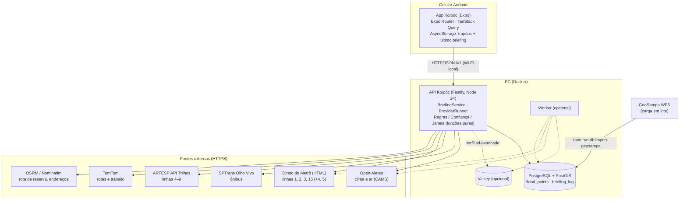

# Καιρός

App Android que responde a uma pergunta: **sair agora ou esperar?** Para cada trajeto que a
pessoa cadastra em São Paulo (origem, destino, linhas de ônibus e de trilhos), o app consulta um
backend próprio, que reúne em paralelo clima, qualidade do ar, previsão de chegada dos ônibus,
situação das linhas de Metrô e trens, trânsito no trajeto e pontos históricos de alagamento. A
resposta é um **briefing**: veredito (**Favorável**, **Atenção**, **Aguardar** ou
**Indeterminado**), motivos, melhor janela meteorológica nas próximas 6 h, nível de confiança e,
para cada dado, a fonte, o horário da observação e o estado (`fresh`, `stale` ou `unavailable`).

*Kairós* (καιρός) é o "momento oportuno".

> **Projeto acadêmico.** O Καιρός é a APS (Atividade Prática Supervisionada) da disciplina de
> **Sistemas Distribuídos**. Não é um produto comercial, não tem suporte nem garantia de
> funcionamento, e os alertas são orientativos: não substituem a Defesa Civil (199), os
> Bombeiros (193) nem os avisos do INMET. Escopo: só a cidade de São Paulo, só fontes gratuitas,
> sem cartão de crédito. Entrega: 10/11/2026 (congelamento de funcionalidades em 02/11/2026).

Integrantes: `Guilherme Guedes, Gustavo Nascimento, Pablo Kayky & Victor Ribeiro`.

**Licença do código:** MIT (arquivo [`LICENSE`](LICENSE)). **Os dados não são cobertos por ela:**
cada fonte tem licença e termos próprios, alguns **não comerciais** — ARTESP (CC BY-NC 4.0),
Open-Meteo (API gratuita só para uso não comercial; dados CC BY 4.0, com atribuição ao CAMS),
OpenStreetMap/Nominatim/OSRM (ODbL), GeoSampa (atribuição à Prefeitura de São Paulo), TomTom
(termos proprietários do plano gratuito) e SPTrans Olho Vivo (termos do cadastro de
desenvolvedor). Detalhes em [Licenças e créditos dos dados](#licenças-e-créditos-dos-dados).
Qualquer uso fora do contexto acadêmico exige rever todas elas.

Feito com React Native + Expo (SDK 57), Node.js 24 + Fastify 5 e PostgreSQL + PostGIS, tudo em
TypeScript, com o contrato entre app e API em Zod.

---

## Sumário

1. [O que o app faz](#1-o-que-o-app-faz)
2. [Como reproduzir](#2-como-reproduzir)
3. [Arquitetura (Frente C)](#3-arquitetura-frente-c)
4. [Escopo, requisitos e regras (Frente B)](#4-escopo-requisitos-e-regras-frente-b)
5. [Testes e resultados medidos (Frente G)](#5-testes-e-resultados-medidos-frente-g)
6. [Decisões de arquitetura (ADRs)](#6-decisões-de-arquitetura-adrs)
7. [Fontes de dados](#7-fontes-de-dados)
8. [Estrutura do código e convenções (Frente F)](#8-estrutura-do-código-e-convenções-frente-f)
9. [Tarefas (T00–T39)](#9-tarefas-t00t39)
10. [Limitações conhecidas e trabalho futuro](#10-limitações-conhecidas-e-trabalho-futuro)
11. [Licenças e créditos dos dados](#licenças-e-créditos-dos-dados)

---

## 1. O que o app faz

| Aba / tela | O que mostra |
|---|---|
| **Trajetos** | Tempo agora (temperatura, sensação, chance de chuva, vento, umidade, UV, nascer/pôr do sol, próximas horas, tendência de chuva em 3 h), o veredito do trajeto principal (segurar o cartão troca o principal) e a lista de trajetos, com favoritos no topo e os demais ordenados por frequência de uso ponderada por recência e horário (tudo calculado só no aparelho). "Para onde vamos?" abre o cadastro. |
| **Briefing** | Veredito no topo com a ação e o porquê; "Melhor horário" (quando o veredito vem de tempo, alagamento ou ar); "O que fazer agora"; "Atrasos e obstáculos"; uma seção por dimensão (ônibus, trilhos, trânsito, clima, ar, alagamento) dizendo se ela pesa ou não no veredito; fontes com falha explicadas em linguagem comum; aviso "Desatualizado" sem rede; compartilhar como texto; atalhos "Abrir no Uber" / "Abrir na 99" quando o veredito é Aguardar; itinerário das linhas de trilho. |
| **Alertas** | Alertas calculados a partir do último briefing e do tempo agora (nível 0–3, com selo na aba), cartões orientativos com as referências públicas usadas (AMS, CONAMA/MMA, OMS, Defesa Civil de SP, INMET) e os botões Defesa Civil 199 e Bombeiros 193, que abrem o discador. |
| **Mapa** | Leaflet + OpenStreetMap: sua posição (aproximada ou exata), a rota real até a origem (a pé) e da origem ao destino (de carro), distâncias, o traçado do último briefing com a faixa de 300 m, e camadas de alagamento, chuva, temperatura e trânsito ao vivo. |
| **Sobre** | "Como o Καιρός funciona" (o sistema distribuído ao vivo: nós, estado, latência e os conceitos aplicados), **Estado das fontes** (estado de cada fonte, contadores, tolerância a falhas e o endereço do servidor da API), "Registro de requisições" do aparelho, relatório agregado do servidor, lembretes de saída, tema claro/escuro/do sistema e as atribuições das fontes. |

Sem conexão com a API, o app mostra o último briefing salvo com "Desatualizado há N min".

---

## 2. Como reproduzir

Este roteiro serve para quem nunca viu o projeto e quer rodá-lo **no próprio computador, no
próprio celular Android e na própria rede Wi-Fi**, sem nada hospedado na nuvem. O backend roda em
Docker no PC; o celular fala com ele pela rede local.

### 2.1 Pré-requisitos

| Item | Para quê | Obrigatório? |
|---|---|---|
| **Docker Desktop** (no Windows, com o backend WSL 2) | Sobe o banco (PostGIS) e a API | Sim |
| **Git** | Clonar o repositório | Sim (ou baixe o ZIP) |
| **Node.js 24** (traz o npm) | Importar os pontos de alagamento (uma vez) e, se quiser, rodar o app pelo Expo Go | Só para a importação e para o caminho Expo Go |
| **Celular Android** na **mesma rede Wi-Fi** do PC | Rodar o app | Sim |
| Chaves gratuitas (SPTrans, TomTom, ARTESP) | Ônibus, trânsito/rotas e linhas 6–9 | Não — ver [2.9](#29-o-que-funciona-sem-chaves) |

O projeto foi desenvolvido e testado num PC Windows com Docker Desktop e num celular Android 12.
Os comandos abaixo funcionam no PowerShell; no macOS/Linux, troque `Copy-Item` por `cp`.

### 2.2 Clonar e configurar o `.env`

```powershell
git clone <url-do-repositório> kairos
cd kairos
Copy-Item .env.example .env
```

Edite o `.env` (fica só no PC; está no `.gitignore` e **nunca** vai para o app):

| Variável | Para que serve | Se ficar vazia |
|---|---|---|
| `DB_PASSWORD` | Senha do PostgreSQL. **Defina antes do primeiro `docker compose up`**: o banco grava a senha na criação do volume | O compose usa `kairos-dev-123` (senha padrão pública) |
| `DB_PORT` | Porta do banco exposta no PC (padrão 5432) | 5432 |
| `API_PORT` | Porta da API no PC (padrão 3000) | 3000 |
| `NODE_ENV`, `LOG_LEVEL` | Ambiente e nível de log (`info`) | Padrões |
| `SPTRANS_TOKEN` | Olho Vivo (ônibus) | Ônibus `unavailable`; a API sobe normalmente |
| `TOMTOM_KEY` | Rotas de carro/a pé e trânsito ao vivo | Rota de carro pelo OSRM, sem trânsito e sem rota a pé no mapa |
| `ARTESP_KEY` | API Trilhos (linhas 4–9) | Linhas 6–9 somem; 4 e 5 vêm da página do Metrô |
| `OSRM_BASE_URL`, `NOMINATIM_BASE_URL` | Servidores próprios de OSRM/Nominatim | Servidores públicos (≤ 1 req/s, User-Agent próprio) |
| `DEMO_MODE`, `DEMO_TOKEN` | Modo demonstração ([2.11](#211-modo-demonstração-cenários-simulados)) | Modo desligado (`/v1/demo/scenario` responde 404) |
| `HISTORICO_SEGREDO` | Segredo do HMAC que transforma o trajeto num código irreversível no histórico (RF26, RNF14); use 32+ caracteres aleatórios | Segredo aleatório a cada boot (a contagem de "trajetos distintos" recomeça) |
| `CACHE_PASSWORD`, `CACHE_PORT`, `API_CACHE_URL`, `CACHE_URL` | Só para o perfil opcional `sd-avancado` ([2.12](#212-perfil-opcional-sd-avancado-valkey--worker)) | Cache LRU em memória (padrão) |

Regra: credenciais só no `.env` do backend. Variáveis `EXPO_PUBLIC_*` entram no bundle do app,
então nunca guarde chaves nelas.

### 2.3 Subir o backend

```powershell
docker compose up -d --build
docker compose ps            # "kairos-db" deve ficar healthy e "kairos-api" Up
```

Isso sobe dois containers: `db` (PostGIS 16-3.4; as tabelas `flood_points`, `dataset_imports` e
`briefing_log` são criadas pelo `apps/api/database/init.sql` na primeira inicialização) e `api`
(Fastify na porta 3000). **Depois de um `--build`, a API leva de 1 a 3 minutos para responder bem**:
no boot ela aquece as conexões com as fontes. Espere antes de testar ou demonstrar.

Conferir no PC:

```powershell
curl.exe http://localhost:3000/v1/health          # {"status":"up",...}
curl.exe http://localhost:3000/v1/health/providers
```

### 2.4 Importar os pontos de alagamento (uma vez; precisa de Node 24 no PC)

A imagem da API não leva os scripts de banco, então a importação roda **no PC**, contra o banco
exposto em `127.0.0.1:5432`, lendo o mesmo `.env`:

```powershell
npm install
npm run db:import-geosampa -w apps/api
```

O script aplica as migrations pendentes (`apps/api/database/migrations/001`–`004`; também há
`npm run db:migrate -w apps/api` para aplicá-las sozinhas), baixa a camada
`risco_ocorrencia_alagamento` do WFS do GeoSampa (292 pontos de 2026, conferidos em 10/10/2026),
converte de EPSG:31983 para 4326 no PostGIS e registra o SHA-256 do conteúdo. Rodar de novo não
duplica nada: se o conteúdo não mudou, sai sem alterar o banco (idempotente, RF20/TC11).

Sem essa importação a API funciona, mas a tabela de pontos fica vazia e a dimensão de alagamento
nunca encontra pontos próximos.

> `npm install` instala o monorepo inteiro (inclusive o app). O npm 12 bloqueia scripts de
> instalação fora da lista `allowScripts` do `package.json` da raiz; se aparecer "install scripts
> blocked", rode `npm install-scripts ls`, leia o script e só então
> `npm install-scripts approve <pacote>`.

### 2.5 Liberar o PC na rede local

1. **Descubra o IP do PC:** `ipconfig` → "Endereço IPv4" do adaptador Wi-Fi (ex.: `192.168.1.20`).
2. **Marque a rede Wi-Fi como Privada:** Configurações → Rede e Internet → Wi-Fi → (sua rede) →
   Tipo de perfil de rede: **Privada**. Em rede **Pública** o Windows bloqueia conexões de entrada.
   Pelo PowerShell (como administrador):
   `Set-NetConnectionProfile -InterfaceAlias "Wi-Fi" -NetworkCategory Private`.
3. **Libere a porta 3000 no firewall** (PowerShell como administrador):
   ```powershell
   New-NetFirewallRule -DisplayName "Kairos API 3000" -Direction Inbound -Protocol TCP -LocalPort 3000 -Action Allow -Profile Private
   ```
4. **Teste no navegador do celular** (mesma Wi-Fi): `http://<IP-do-PC>:3000/v1/health`. Deve
   aparecer `{"status":"up",...}`. Se não abrir, veja [2.13](#213-problemas-comuns).

Redes de faculdade e de empresa costumam isolar os aparelhos entre si: nesse caso, use o hotspot
do celular (ou um roteador próprio) e conecte o PC a ele.

### 2.6 Instalar o `.apk`

1. Baixe o `.apk` na página **Releases** do repositório no GitHub (pelo celular, ou no PC e
   transfira por cabo).
2. Abra o arquivo e permita "instalar apps desconhecidos" para o navegador ou gerenciador de
   arquivos, se o Android pedir.

### 2.7 Apontar o app para o seu PC

O `.apk` sai do build com o endereço da máquina de desenvolvimento do grupo, que não existe na sua
rede. Ajuste no próprio app:

1. Abra o Καιρός → aba **Sobre** → **"Estado das fontes"** → seção **"Servidor da API"**.
2. Digite o endereço do PC com a porta, por exemplo `192.168.1.20:3000`.
3. Toque em **"Testar conexão"**; com sucesso, toque em **"Salvar"**.

A partir daí, cadastre um trajeto ("Para onde vamos?") e abra o briefing.

### 2.8 Alternativa: rodar o app pelo Expo Go

Útil para desenvolver ou se não quiser instalar o `.apk`. Precisa de Node 24 no PC e do app
**Expo Go** (compatível com o SDK 57) no celular.

```powershell
npm install
npm run build                       # compila packages/contracts (o app importa o dist) e a API
```

Crie `apps/mobile/.env` com o endereço do PC:

```
EXPO_PUBLIC_API_URL=http://192.168.1.20:3000
```

```powershell
npm run dev -w apps/mobile          # expo start --lan; escaneie o QR code com o Expo Go
```

O Metro (empacotador do Expo) também precisa ser alcançável pelo celular: se o Windows perguntar,
permita o Node.js na rede **Privada** (ou libere a porta 8081). O endereço configurado em
"Servidor da API" ([2.7](#27-apontar-o-app-para-o-seu-pc)) também vale no Expo Go.

**Limitação:** no Expo Go do Android os **lembretes de saída (RF25) não funcionam** — o
`expo-notifications` não pode nem ser carregado ali (SDK 53+), então o app esconde a função. No
`.apk` eles funcionam.

### 2.9 O que funciona sem chaves

| Configuração | O que funciona | O que fica de fora |
|---|---|---|
| **Nenhuma chave** | Clima e "tempo agora" (Open-Meteo), qualidade do ar (CAMS), alagamento (GeoSampa no PostGIS, após [2.4](#24-importar-os-pontos-de-alagamento-uma-vez-precisa-de-node-24-no-pc)), busca de endereço (Nominatim), rota de carro de reserva (OSRM), linhas **1, 2, 3, 4, 5 e 15** pela página "Direto do Metrô" | Ônibus, trânsito, rota a pé, linhas 6–9 |
| Sem `TOMTOM_KEY` | Rota de carro pelo OSRM | Dimensão `traffic` (`unavailable`), camada de trânsito do mapa e rota a pé. Trajetos **com ônibus** ficam no máximo com confiança **MÉDIA** (o trânsito é relevante para o ônibus, RN09) |
| Sem `SPTRANS_TOKEN` | Tudo o mais; a API sobe e avisa no log | Ônibus `unavailable` (busca de linhas/paradas e previsão de chegada) |
| Sem `ARTESP_KEY` | Linhas 4 e 5 pela página do Metrô | Linhas **6, 7, 8 e 9** nem aparecem na lista (ver limitação da [B.11](#b11-fora-do-escopo-e-limitações)) |
| **Modo demonstração** | Todos os cenários simulados, inclusive ônibus, trilhos e trânsito, **sem nenhuma chave** | — (exige `DEMO_MODE=true` e qualquer valor em `DEMO_TOKEN`) |

### 2.10 Como obter as chaves (todas gratuitas, sem cartão)

| Chave | Onde | Observações |
|---|---|---|
| `SPTRANS_TOKEN` | <https://www.sptrans.com.br/desenvolvedores/> | Cadastro de desenvolvedor e criação de um "aplicativo" para receber o token da API Olho Vivo |
| `TOMTOM_KEY` | <https://developer.tomtom.com/> | Conta gratuita, sem cartão. Copie o valor **completo** da chave no painel (um valor truncado dá 403) |
| `ARTESP_KEY` | <https://ccm.artesp.sp.gov.br/metroferroviario/api/docs/> | Cadastro com **aprovação manual** (pode levar dias). Limite de **12 requisições/hora por credencial**; 403 indica IP fora da lista permitida da credencial ou termos de uso não aceitos. Dados CC BY-NC 4.0 |

### 2.11 Modo demonstração (cenários simulados)

O modo demonstração troca as fontes reais por provedores simulados com cenários nomeados, para
mostrar regras e falhas de forma reprodutível (RF19). Os dados simulados saem marcados como
`simulado:<fonte>` e têm cache, circuit breaker e saúde separados dos reais.

1. No `.env`: `DEMO_MODE=true` e `DEMO_TOKEN=<qualquer valor; prefira 32+ caracteres aleatórios>`
   (com `DEMO_MODE=true` e sem token, a API se recusa a subir).
2. Recrie a API para ler o `.env`: `docker compose up -d api`.
3. Liste os cenários e ative um (o cabeçalho `X-Demo-Token` é obrigatório):

```powershell
curl.exe -H "X-Demo-Token: SEU_TOKEN" http://localhost:3000/v1/demo/scenario
curl.exe -X POST -H "X-Demo-Token: SEU_TOKEN" -H "Content-Type: application/json" `
  -d '{\"cenario\":\"chuva-forte\"}' http://localhost:3000/v1/demo/scenario
```

4. Peça o briefing no app (puxe para atualizar). Para voltar às fontes reais, ative `real`.

Respostas: 404 com o modo desligado (como se a rota não existisse), 401 sem token, 403 com token
errado, 400 com nome de cenário inválido.

| Cenário | O que simula | Resultado esperado (trajeto de referência: ônibus 875A-10 + Linha 1) |
|---|---|---|
| `real` | Nenhuma simulação: fontes reais | — |
| `normal` | Tudo tranquilo | FAVORÁVEL, confiança ALTA |
| `chuva-forte` | 12 mm/h na próxima hora | AGUARDAR (RN01) |
| `chuva-moderada` | 5 mm/h | ATENÇÃO (RN02) |
| `alagamento` | 4 mm/h + pontos a 120 m e 260 m | AGUARDAR (RN03 e RN02) |
| `ar-ruim` | MP2,5 média de 24 h = 62 µg/m³ | ATENÇÃO (RN05) |
| `onibus-demorado` | Próximo ônibus em 35 min | ATENÇÃO (RN07) |
| `trilho-paralisado` | 1ª linha do trajeto paralisada | AGUARDAR (RN06) |
| `trilho-intervalos` | "Maiores Intervalos" com explicação da operadora | ATENÇÃO (RN06) |
| `transito-intenso` | 10 min de atraso sobre 14 min livres | ATENÇÃO (RN09, com ônibus) |
| `sptrans-fora` | Olho Vivo com HTTP 503 | FAVORÁVEL, MÉDIA, ônibus `unavailable` (TC12) |
| `dados-obsoletos` | Clima de 30 min e ônibus de 1 min atrás | FAVORÁVEL, MÉDIA, clima e ônibus `stale` (TC15) |
| `resposta-invalida` | Clima sem campo obrigatório, ar com JSON malformado | FAVORÁVEL, BAIXA, os dois `unavailable` (TC14) |
| `clima-lento` | Clima responde só após 10 s | FAVORÁVEL, BAIXA, clima `unavailable` pelo timeout de 3 s (TC13) |
| `tudo-fora` | Todas as fontes fora | INDETERMINADO, BAIXA (RN08) |

O cenário vale para todos os briefings enquanto estiver ativo. Os resultados da tabela são
conferidos por teste para o trajeto de referência; num trajeto sem ônibus ou sem trilhos, os
cenários dessas dimensões não têm efeito. O catálogo fica em `apps/api/src/modules/demo/cenarios.ts`
e os simulados em `apps/api/src/providers/simulated/`.

### 2.12 Perfil opcional `sd-avancado` (Valkey + worker)

Demonstra um cache **compartilhado entre processos** (RF27, ADR 06): um container Valkey e um
worker separado que mantém quentes as chaves de clima, ar, Metrô e alagamento. O worker não tem
credenciais e **nunca** chama ARTESP, Olho Vivo, TomTom, OSRM nem Nominatim.

```powershell
docker compose --profile sd-avancado up -d --build cache worker
# no .env: API_CACHE_URL=redis://cache:6379   (e, se quiser, troque CACHE_PASSWORD)
docker compose up -d api
```

Se o Valkey cair, a API volta sozinha ao LRU em memória. Fora do Docker (`npm run dev`), use
`CACHE_URL=redis://127.0.0.1:6379`.

### 2.13 Problemas comuns

- [ ] **O celular não abre `http://<IP>:3000/v1/health`:** rede marcada como Pública, porta 3000
  não liberada, IP errado (o IP do PC muda com DHCP: confira de novo com `ipconfig`), ou rede que
  isola os aparelhos (use o hotspot do celular). Teste primeiro no navegador do celular.
- [ ] **O briefing sai INDETERMINADO ou com tudo `unavailable` logo depois de subir:** o container
  ainda está aquecendo (as primeiras conexões com as fontes chegaram a 31 s em 13/10/2026). Espere
  1–3 minutos e peça de novo. A primeira busca de endereço após subir também é lenta.
- [ ] **Fontes estourando o tempo com a máquina carregada:** com testes, Expo, navegador e Docker
  ao mesmo tempo, as fontes passam dos 3 s e o circuit breaker abre por 60 s. Os contadores de
  Provedores guardam isso desde que a API subiu. Não rode builds ou testes durante a demonstração.
- [ ] **Docker Desktop travado** (`docker info` não responde; os testes de integração passam a ser
  pulados em silêncio): feche o Docker Desktop, rode `wsl --shutdown`, reabra, espere o "engine
  running" (~2 min), suba `docker compose up -d db`, espere `healthy` e depois `docker compose up -d api`.
- [ ] **`db` unhealthy depois de o Docker fechar de forma abrupta:** o PostgreSQL está se
  recuperando (fsync lento). Espere alguns minutos até `healthy` e rode `docker compose up -d api`.
- [ ] **Erro de senha do banco na importação:** o `DB_PASSWORD` mudou depois da criação do volume.
  Volte ao valor antigo, ou recrie o banco com `docker compose down -v` (**apaga os dados**) e
  importe de novo.
- [ ] **Linhas 4–9 sem dados da ARTESP:** o orçamento é de **12 chamadas/h por credencial** e
  **cada boot da API gasta 1** no aquecimento (reiniciar o container ou salvar arquivos com
  `npm run dev --watch` conta). A API se limita a 10/h e respeita o `Retry-After` do 429. Não
  reinicie a API em laço nem rode `apps/api/scripts/verificar-artesp.ts` repetidamente.
- [ ] **TomTom 403:** chave copiada truncada do painel.
- [ ] **`.apk` instalado mas sem conexão com a API:** confira "Servidor da API" ([2.7](#27-apontar-o-app-para-o-seu-pc)).
  O `.apk` já libera HTTP sem TLS para a rede local (`usesCleartextTraffic`).
- [ ] **Versão web do app (`expo start --web`) não consegue chamar a API:** a API não envia
  cabeçalhos CORS; o app nativo não precisa deles.

### 2.14 Desenvolvimento, testes e build do `.apk`

```powershell
npm run dev                          # API local com recarga (lê o .env da raiz; banco em 127.0.0.1)
npm run build                        # contrato + API
docker compose up -d db              # antes dos testes: os de integração do PostGIS são pulados sem o banco
npm test                             # contracts e API (Vitest) + app (Jest)
npm run test:coverage -w apps/api    # cobertura da API
npm run lint
npm run typecheck                    # API (com testes) e app (com testes)
```

Na suíte completa da raiz, um ou outro arquivo pode estourar o tempo só por carga da máquina;
rode o pacote sozinho para confirmar.

**`.apk`:** EAS Build, perfil `preview` de `apps/mobile/eas.json` (gera `.apk`, Node 24.21.0). O
gancho `eas-build-post-install` compila `packages/contracts` no servidor de build, porque o `dist`
não vai no upload. Antes de cada build, inspecione o pacote enviado
(`eas build:inspect --stage archive`) e confira que não há `.env` nem chaves; depois do build,
descompacte o `.apk` e procure os valores do `.env` (TC25). O perfil `production` (AAB para loja)
existe, mas só faz sentido com uma API pública.

---

## 3. Arquitetura (Frente C)

### C.1 Por que é um sistema distribuído

- **Componentes autônomos em máquinas diferentes:** celular, PC (API + banco em containers) e
  sete serviços externos de organizações distintas.
- **Comunicação só por mensagens:** HTTP/JSON. Nenhum componente acessa a memória de outro.
- **Falhas parciais e independentes:** a queda de uma fonte não derruba o briefing (RF15).
- **Sem relógio nem estado globais:** cada observação carrega o próprio carimbo de tempo e o
  sistema raciocina sobre a recência (RF12, RF13) — consistência fraca/eventual assumida de forma
  explícita.
- **Transparência:** o app não sabe quantas fontes existem nem onde estão (acesso, localização e
  falha).
- **Concorrência:** as consultas de um briefing rodam em paralelo, com prazo global.

### C.2 Componentes



### Fluxo de um briefing

```mermaid
sequenceDiagram
  participant App
  participant API as API (BriefingService)
  participant R as ProviderRunner (por fonte)
  participant F as Fonte externa
  App->>API: POST /v1/briefings (trajeto)
  API->>API: valida com Zod (400 problem+json se inválido)
  API->>API: geometria do trajeto (TomTom → OSRM → linha reta)
  par fan-out (Promise.allSettled, prazo global 4 s)
    API->>R: clima, ar, ônibus, trilhos, trânsito, alagamento
    R->>R: cache LRU (fresh? devolve)
    R->>R: circuit breaker aberto? → cache vencido
    R->>R: limite de taxa
    R->>F: requisição (timeout 3 s)
    F-->>R: resposta
    R->>R: valida com Zod → Observation {fresh|stale|unavailable}
  end
  API->>API: RN01–RN09 → veredito; C1–C3 → confiança; janela meteorológica
  API-->>App: 200 briefing (sempre, mesmo com fontes fora)
  App->>App: valida no mesmo contrato e persiste o último briefing
```

Cada fonte passa pelo mesmo `ProviderRunner` (um por processo da API): **cache LRU → circuit
breaker → limitador de taxa → timeout → validação Zod → `Observation`** com `source`,
`observedAt`, `fetchedAt`, `ttlSeconds`, `status` e, quando `unavailable`, um `motivo`
obrigatório.

### C.3 Responsabilidades

| Componente | Responsabilidade | Depende de |
|---|---|---|
| App | Cadastro e armazenamento local dos trajetos, chamada à API, exibição, cache offline | API, `contracts` |
| `packages/contracts` | Schemas Zod e tipos compartilhados (app e API validam as mesmas mensagens) | — |
| BriefingService | Orquestração, prazo global, composição dos trilhos, montagem da resposta | Adaptadores, regras, FloodRisk, cache |
| Adaptadores de provedor | Chamar a fonte, validar, normalizar no envelope, mapear erros | Cliente HTTP, CachePort, CircuitBreaker |
| Regras / Confiança / Janela | Funções puras com `agora` explícito (RN01–RN09, C1–C3, janela) | `contracts` |
| FloodRiskService | `ST_DWithin` entre a geometria do trajeto e os pontos | PostGIS |
| RouteGeometryService | TomTom (com chave) → OSRM → linha reta (esta só para o raio de alagamento, nunca exibida); nunca lança | Adaptadores TomTom e OSRM, cache |
| CachePort | `get`, `set` com TTL e `getStale` | LRU em memória ou Valkey |
| Demo | Troca os adaptadores reais pelos simulados conforme o cenário, por requisição | Adaptadores simulados |

### C.4 API (contrato v1)

| Método e rota | Uso | RF |
|---|---|---|
| `POST /v1/briefings` | Briefing de um trajeto | RF05 |
| `GET /v1/geocode?q=` | Busca de endereço (Nominatim), só ao confirmar — sem autocomplete | RF01 |
| `GET /v1/transit/bus/lines?q=` · `GET /v1/transit/bus/stops?lineCode=` | Linhas e paradas (Olho Vivo) | RF02 |
| `GET /v1/transit/rail/lines` | Linhas de trilho com fonte configurada | RF03 |
| `GET /v1/weather?lat=&lon=` | Clima para o widget "tempo agora" (mesmo cache do briefing; fonte fora → `unavailable`, nunca 500) | RF06 |
| `GET /v1/rota?de=lat,lon&para=lat,lon&modo=a-pe\|carro` | Rota real para o mapa (TomTom; `carro` cai para o OSRM). 400 validação; 503 sem rota — **nunca linha reta** | RF24 |
| `GET /v1/mapa/transito/{z}/{x}/{y}.png` | Tiles de fluxo de trânsito da TomTom via proxy (a chave fica no servidor); zoom 10–18, só a área de SP; 503 sem chave/cota | RF22 |
| `GET /v1/mapa/camadas` | Pontos de alagamento (PostGIS) e grade de chuva/temperatura (Open-Meteo, 12 regiões); camada fora vira `unavailable`, nunca 500 | RF23 |
| `GET /v1/health` · `GET /v1/health/providers` | Liveness e estado por fonte: status, última latência, último sucesso, `requestCount`, `successCount`, `avgLatencyMs` (só chamadas reais à fonte desde o boot; cache, breaker aberto e limite não contam) | RF18 |
| `GET /v1/reports/summary` | Vereditos por dia e disponibilidade por provedor | RF26 |
| `GET` · `POST /v1/demo/scenario` | Modo demonstração (`DEMO_MODE=true` + `X-Demo-Token`) | RF19 |

Exemplos validados de requisição e resposta ficam em `packages/contracts/examples/`. Erros seguem
o **RFC 9457** (`application/problem+json`), por exemplo:
`{ "type": "…/validation", "title": "Entrada inválida", "status": 400, "detail": "trajeto.origem.lat fora do intervalo", "instance": "/v1/briefings" }`.
No app, 4xx/5xx viram mensagem em pt-BR a partir do `title`.

### C.5 Falhas, TTL e limites

| Fonte | TTL | Timeout | Limite respeitado |
|---|---|---|---|
| Open-Meteo clima | 15 min | 3 s | — (plano não comercial: < 10 mil chamadas/dia) |
| Open-Meteo ar | 60 min | 3 s | — |
| Olho Vivo previsão | 30 s | 3 s | Nova autenticação uma vez ao receber 401 |
| Olho Vivo linhas/paradas | 24 h | 3 s | — |
| ARTESP (linhas 4–9) | **6 min**; uma chamada serve todas as linhas | 3 s | ≤ 10 req/h (abaixo de 12) + bloqueio pelo `Retry-After` no 429; fora da renovação antecipada (daria 12,5/h); 1 chamada de aquecimento por boot |
| Página Direto do Metrô | 5 min; uma consulta serve todas as linhas | 3 s | — |
| TomTom rotas | Carro 5 min; a pé 1 dia (par arredondado a ~11 m); briefing e `/v1/rota` de carro dividem a entrada | 3 s | ≤ 600/24 h e 4/s; 429 bloqueia até o `Retry-After`; sem aquecimento nem renovação antecipada |
| TomTom tiles de trânsito | 2 min (LRU próprio, 300 tiles) | 3 s | ≤ 6.000/24 h e 8/s; zoom 10–18 e área de SP |
| OSRM (reserva de carro) | 7 dias por par origem/destino | 3 s | ≤ 1 req/s (fila serial) |
| Nominatim | 30 dias | 3 s | ≤ 1 req/s (fila serial), User-Agent próprio |
| GeoSampa/PostGIS (alagamento) | 24 h | 3 s | Consulta local via runner (banco fora → `unavailable`) |

As cotas da TomTom são contadas em memória e zeram a cada boot.

- **Prazo global do briefing: 4 s.** O que não respondeu vira `unavailable`, ou `stale` se houver
  cache vencido.
- **Circuit breaker:** abre após 3 falhas seguidas, fica aberto 60 s e então faz uma tentativa
  meio-aberta. Aberto, a dimensão sai direto do cache vencido.
- **Resposta externa inválida** (falha no schema) conta como falha, vai ao log com o trecho
  inválido, e a dimensão fica `unavailable`.
- **Conexões frias:** medido no container em 13/10/2026 — a 1ª conexão com a Open-Meteo e com a
  página do Metrô chegou a 31 s, e o Node 24 dava só 250 ms por endereço na escolha IPv6/IPv4 (o
  container não tem IPv6). Correções em `apps/api/src/infrastructure/`:
  1. `network.ts`: 1 s por endereço na escolha de família;
  2. `warm-up.ts`: aquecimento no boot, uma consulta por fonte com prazo de 15 s, sem bloquear o boot;
  3. `refresh-ahead.ts`: **renovação antecipada** (variante de *stale-while-revalidate*) só para
     clima, ar, Metrô e alagamento — até 50 chaves recentes, esquecidas após 6 h sem pedido;
     varredura a cada 30 s renova a partir de 80 % do TTL, com prazo de fundo de 15 s, fora do prazo
     de 4 s do briefing; sem renovação duplicada; respeita breaker e limitadores; uma falha não
     apaga o cache bom. Custo: ~5 chamadas/h por chave de clima, ~1,25/h de ar e 15/h do Metrô.
     Desligada nos testes.
- **Hora observada (`observedAt`):** a idade de cada dado é contada de forma que um dado recém-
  buscado não nasça `stale`:
  - Open-Meteo: fim do intervalo de `current` (900 s no clima, 3.600 s no ar), limitado ao agora;
  - Olho Vivo: o campo `hr` só traz HH:MM, então vale o fim do minuto informado, limitado ao agora;
  - ARTESP: `meta.timestamp` + 5 min (fim do retrato servido pela ARTESP), limitado ao agora — o
    `status.atualizado_em` é a hora da última *mudança* e deixaria toda linha normal `stale`; numa
    chamada medida, o `meta.timestamp` veio 193 s antes da resposta;
  - página do Metrô: hora da leitura bem-sucedida.
- **Composição dos trilhos:** com chave, 4–9 vêm da ARTESP e 1, 2, 3 e 15 da página do Metrô, em
  paralelo; se a ARTESP vier sem dado, 4 e 5 caem para a página. Uma única observação `rail`, com
  `fonte` e `detalhe` por linha; `source` = `artesp`, `metro-sp` ou `artesp+metro-sp`; `status` =
  o pior entre as fontes com dado; uma fonte que falhou sem resgate é citada no `motivo`.
- **Modo demonstração:** simulados usam `source = "simulado:<fonte real>"` e os mesmos TTLs; cache,
  breaker e saúde ficam separados dos reais.
- **No app:** sem conexão, mostra o último briefing persistido (guardado por 7 dias) e refaz a
  consulta quando a rede volta ou o app volta ao primeiro plano.

### C.6 Persistência e sincronização

- **Aparelho (AsyncStorage):** trajetos (`kairos:trajetos:v1`), último briefing por trajeto (cache
  persistido do TanStack Query, `kairos:query-cache:v1`), uso dos trajetos para a ordenação
  (`kairos:uso-trajetos:v1`) e tema (`kairos:tema:v1`). Nada disso vai para o servidor.
- **PostGIS:**
  - `flood_points(id, source_id UNIQUE, occurred_on, address, geom geometry(Point,4326))` com
    índice GiST (e índice por `geography`, migration 003);
  - `dataset_imports(id, source, file_hash, rows, imported_at)` — idempotência da importação;
  - `briefing_log(id, created_at, route_hash, verdict, confidence, provider_status jsonb, latency_ms)`
    — histórico do RF26 (índice por data na migration 004). O modo demonstração não grava.
- **Distância:** `ST_DWithin(geom::geography, :rota::geography, 300)`, ou seja, metros reais.
- **Sincronização:** não há estado do usuário no servidor. A "sincronização" é a revalidação
  temporal: o app usa `staleTime` de 60 s e refaz a consulta ao reconectar ou voltar ao primeiro
  plano; o servidor revalida por TTL.

### C.7 Autenticação

Não há login de usuário (fora do escopo; ver RNF14). Credenciais das fontes ficam só no servidor;
o app não recebe nenhuma chave. O endpoint de demonstração exige `DEMO_MODE=true` e o cabeçalho
`X-Demo-Token` (comparação em tempo constante; o token nunca vai para o log).

### Conceitos de Sistemas Distribuídos no código

| Conceito | Como aparece | Onde |
|---|---|---|
| Heterogeneidade e transparência de acesso | JSON (Open-Meteo, SPTrans, ARTESP, TomTom), HTML (Direto do Metrô) e WFS/SQL (GeoSampa no PostGIS) viram a mesma `Observation` tipada | `apps/api/src/providers/*`, `packages/contracts` |
| Concorrência com prazo | Fan-out em paralelo (`Promise.allSettled`), prazo global de 4 s e 3 s por fonte | `modules/briefing/briefing.service.ts` |
| Falha parcial e degradação controlada | Cada dimensão sai `fresh`, `stale` (até 3× o TTL) ou `unavailable` com motivo; a confiança cai e o veredito sai mesmo assim | `infrastructure/provider-runner.ts` |
| Isolamento de falhas | Circuit breaker por fonte | `infrastructure/circuit-breaker.ts` |
| Replicação e frescor | Cache com TTL por fonte, renovação antecipada a 80 % e aquecimento no boot | `infrastructure/refresh-ahead.ts`, `warm-up.ts` |
| Redundância | ARTESP fora → linhas 4 e 5 pela página do Metrô; TomTom fora → OSRM | `modules/briefing/`, `modules/routing/` |
| Controle de carga | Só o servidor fala com as fontes: ARTESP ≤ 10 req/h, OSRM e Nominatim ≤ 1 req/s, cotas da TomTom — mesmo com muitos celulares | `infrastructure/rate-limiter.ts` |
| Cache compartilhado entre processos | Valkey + worker (perfil `sd-avancado`) | `infrastructure/cache/valkey-cache.ts`, `worker.ts` |
| Contrato entre nós | App e API validam com os mesmos schemas Zod, versão em `CONTRACT_VERSION` | `packages/contracts` |
| Operação desconectada | Último briefing persistido; revalidação ao reconectar | `apps/mobile/src/shared/api/persister.ts`, `network.ts` |
| Idempotência | Importação do GeoSampa por SHA-256 do conteúdo, upsert por `source_id` | `apps/api/database/scripts/import-geosampa.ts` |
| Injeção de falhas | Modo demonstração com cenários nomeados | `modules/demo/cenarios.ts` |
| Observabilidade nas duas pontas | Servidor: log JSON por requisição e contadores por fonte (`/v1/health/providers`). App: "Registro de requisições" com as últimas 50 chamadas (rota sem query string, status, latência, tamanho, dimensões degradadas) | `modules/health/`, `apps/mobile/src/shared/api/registro.ts` |

A tela "Como o Καιρός funciona" lê esses números ao vivo; nada é fixo no app.

### Contrato e versionamento

`packages/contracts` exporta os schemas Zod (envelope `Observation`, briefing, geo, erros, rotas) e
a constante **`CONTRACT_VERSION` = `1.6.0`**. As mudanças desde a v1 inicial foram aditivas (campos
novos, obrigatórios mas *nullable* quando a fonte pode não ter o valor), por isso só a versão
menor subiu:

| Versão | O que entrou |
|---|---|
| 1.1.0 | Clima: `atual.ventoKmH` e `sol {nascer, por}` |
| 1.2.0 | Clima: `codigoTempo` (WMO), `sensacaoC`, `umidadePct`, `uv`, `hoje` (máx./mín.); `ProviderHealth.requestCount/successCount/avgLatencyMs` |
| 1.3.0 | Trilhos: `fonte` e `detalhe` (explicação da operadora) por linha |
| 1.4.0 | `GET /v1/mapa/camadas` |
| 1.5.0 | Dimensão `traffic` (distância, tempo livre e atual, atraso, nível, trechos lentos); regra RN09 |
| 1.6.0 | `GET /v1/reports/summary` |

O schema de motivo aceita identificadores de regra `RN01`–`RN19` (as posições após RN09 ficam
reservadas para regras futuras) e rejeita `RN20` em diante. `unavailable` sempre exige `motivo`.

---

## 4. Escopo, requisitos e regras (Frente B)

### B.1–B.3 Problema e objetivos

Quem se desloca em São Paulo consulta separadamente previsão do tempo, qualidade do ar, ônibus,
Metrô/trem e risco de alagamento, de provedores independentes com atualização e confiabilidade
diferentes, e junta tudo de cabeça para decidir se sai agora. Objetivo: uma aplicação móvel
distribuída que agregue essas observações para um trajeto cadastrado e apresente uma recomendação
justificada, com fonte, recência e confiança de cada dado, que continue funcionando quando parte
das fontes falha.

- **OE1** — Integrar ao menos 6 fontes externas independentes por meio de adaptadores.
- **OE2** — Gerar o briefing com veredito, motivos, recência e confiança por regras explícitas.
- **OE3** — Responder parcialmente quando uma fonte falhar, atrasar ou responder dado inválido.
- **OE4** — Respeitar os limites de taxa das fontes com cache e TTL.
- **OE5** — Usar consulta espacial (PostGIS) para cruzar o trajeto com áreas históricas de alagamento.
- **OE6** — Entregar um `.apk` instalável e um roteiro de demonstração reprodutível, com cenários de falha.

Público-alvo: quem faz deslocamentos **recorrentes** em SP de transporte público (ex.: casa ↔
faculdade/trabalho).

### B.6 Fluxos principais

- **F1 — Cadastrar trajeto:** "Novo trajeto" → origem (GPS ou endereço) → destino → ponto de
  ônibus e até 3 linhas (opcional) → linhas de trilho (opcional) → salvar.
- **F2 — Sair agora?:** escolher um trajeto → `POST /v1/briefings` → veredito, motivos, janela,
  confiança e recência.
- **F3 — Falha parcial:** uma fonte falha → a dimensão chega `unavailable` → a confiança cai → o
  veredito usa só os dados disponíveis.
- **F4 — Sem conexão com a API:** o app mostra o último briefing salvo, com "Desatualizado há N min".
- **F5 — Estado dos provedores:** uma tela lista cada fonte com estado, latência e último sucesso.
- **F6 — Demonstração:** o apresentador ativa um cenário e o briefing reflete a mudança.

### B.7 Requisitos funcionais

Prioridade: **M** = obrigatório; **S** = desejável; **C** = se houver tempo.

| ID | Requisito | Prior. | Situação |
|---|---|---|---|
| RF01 | Cadastrar trajeto com nome, origem e destino (GPS ou busca de endereço) | M | Implementado |
| RF02 | Vincular um ponto de ônibus e até 3 linhas, buscados no Olho Vivo via API | M | Implementado |
| RF03 | Vincular linhas de trilho com fonte configurada: 1, 2, 3, 4, 5 e 15 (página do Metrô) e 6, 7, 8, 9 (ARTESP, só com chave) | M | Implementado |
| RF04 | Listar, editar e excluir trajetos salvos no aparelho | M | Implementado (com favoritos, principal e Desfazer) |
| RF05 | Solicitar o briefing de um trajeto | M | Implementado |
| RF06 | Clima atual e previsão horária (próximas 6 h) | M | Implementado |
| RF07 | Qualidade do ar (MP2,5 e índice), sempre rotulada "estimativa de modelo" | M | Implementado |
| RF08 | Previsão de chegada das linhas vinculadas no ponto | M | Implementado |
| RF09 | Status das linhas metroferroviárias vinculadas (ARTESP) | M | Implementado |
| RF10 | Risco de alagamento: pontos históricos a ≤ 300 m do trajeto, combinados com a chuva prevista | M | Implementado |
| RF11 | Veredito (FAVORÁVEL / ATENÇÃO / AGUARDAR / INDETERMINADO) com motivos que citam a dimensão | M | Implementado |
| RF12 | Fonte, `observedAt`, `fetchedAt` e estado (`fresh/stale/unavailable`) por dimensão | M | Implementado |
| RF13 | Confiança ALTA/MÉDIA/BAIXA pela regra C1–C3 | M | Implementado |
| RF14 | "Melhor janela meteorológica" nas próximas 6 h (ou `null`) | M | Implementado |
| RF15 | Tolerar falhas parciais: timeout por fonte, validação, circuit breaker, dado vencido | M | Implementado |
| RF16 | Cache com TTL por fonte, respeitando os limites de taxa | M | Implementado |
| RF17 | Mostrar o último briefing quando a API estiver inacessível | M | Implementado |
| RF18 | Tela e endpoint de estado dos provedores | M | Implementado |
| RF19 | Modo demonstração com cenários nomeados, só com `DEMO_MODE=true` e token | M | Implementado |
| RF20 | Importar o GeoSampa de alagamentos para o PostGIS (script idempotente) | M | Implementado |
| RF21 | Status das linhas 1, 2, 3, 4, 5 e 15 pela página oficial "Direto do Metrô" | S | **Parcial por decisão:** só Metrô; na 4 e na 5 a ARTESP tem precedência quando há chave; **CPTM (10–13) fora** (site atrás de anti-bot) |
| RF22 | Indicador de trânsito no trajeto | S | **Reaberto com a TomTom:** dimensão `traffic` no briefing (regra RN09) e camada de fluxo no mapa. (A primeira versão, pelo KMZ do Olho Vivo, foi cortada: endpoint instável e sem velocidades no spike T04) |
| RF23 | Mapa com o trajeto e os pontos de alagamento próximos | S | Implementado (Leaflet em WebView, camadas, posição e distâncias) |
| RF24 | Geometria do trajeto: TomTom → OSRM → linha reta (esta só para o raio de alagamento, nunca exibida) | M | Implementado; `GET /v1/rota` nunca devolve linha reta |
| RF25 | Lembrete local no horário habitual de saída | C | Implementado (não funciona no Expo Go do Android) |
| RF26 | Histórico de briefings e relatório agregado | S | Implementado |
| RF27 | Worker separado que pré-aquece o cache, com Valkey compartilhado | C | Implementado (perfil `sd-avancado`) |

Nenhum RF está cortado hoje. **O app nunca mostra rota ou distância em linha reta.**

### B.8 Regras de negócio (tabela de decisão)

Cada limiar tem uma referência conferida na fonte original (**[REF n]**, ver
[B.8.1](#b81-referências-conferidas)) ou é **decisão de projeto**. Os limiares são constantes em
`apps/api/src/modules/rules/thresholds.ts`, com o ID da regra no comentário.

**Convenções**
- `agora` = hora do briefing (America/Sao_Paulo). A precipitação horária da Open-Meteo é a **soma
  da hora anterior** ao carimbo, em mm com uma casa decimal. "Próximas 2 h" = valores com carimbo em
  `(agora, agora + 2 h]`.
- Os limiares de chuva são comparados com `>`: com resolução de 0,1 mm, `> 2,5` equivale a `≥ 2,6`
  e `> 7,6` a `≥ 7,7`.

| ID | Condição exata | Efeito | Limiar e origem |
|---|---|---|---|
| RN01 | Algum valor horário em `(agora, agora + 2 h]` com precipitação **> 7,6 mm/h** (chuva forte) | AGUARDAR | 7,6 mm/h = 0,76 cm/h, limite superior da chuva "moderada" da AMS [REF 1]. Janela de 2 h: decisão de projeto |
| RN02 | Maior valor horário em `(agora, agora + 2 h]` **> 2,5 e ≤ 7,6 mm/h** (moderada) | ATENÇÃO | 2,5 mm/h = 0,25 cm/h, limite superior da chuva "fraca" da AMS [REF 1] |
| RN03 | Ponto de alagamento a **≤ 300 m** da geometria do trajeto **e** algum valor horário em `(agora, agora + 2 h]` **> 2,5 mm/h** | AGUARDAR (dimensão `flood`) | 300 m e 2 h: decisão de projeto (mesmo raio usado com a linha reta, ADR 13). Chuva > 2,5: mesma fronteira da RN02 [REF 1] |
| RN04 | Ponto de alagamento a ≤ 300 m e **nenhum** valor em `(agora, agora + 2 h]` > 2,5 mm/h | INFORMATIVO (não altera o veredito) | Decisão de projeto |
| RN05 | Média das últimas 24 h de MP2,5 (`pm2_5` horário da Open-Meteo com `past_days=1`) **> 50 µg/m³** | ATENÇÃO (dimensão `air`) | Início da faixa **N3 – Ruim** do IQAr atualizado do MMA [REF 3]; coincide com o padrão **PI-2** de MP2,5 em 24 h, vigente desde 01/01/2025 (Res. **CONAMA 506/2024**, art. 4º § 2º e Anexo I) [REF 2]. Usar a média de 24 h do modelo CAMS no lugar de estação: decisão de projeto |
| RN06 | Linha de trilho vinculada com `situacao` ≠ `NORMAL` | ATENÇÃO; se `PARALISADA`, AGUARDAR | Decisão de projeto. Normalização: "Operação Normal" → `NORMAL`; texto com "paralisad" ou "encerrad" → `PARALISADA` ("Operação Encerrada" gera AGUARDAR, porque a linha não pode ser usada; o motivo mostra o texto original); qualquer outro texto → `ALTERADA`; sem dado → dimensão `unavailable`, sem motivo. Vistos na ARTESP: "Operação Normal", "Maiores Intervalos", "Operação Encerrada"; no Metrô: "Operação Normal", "Operação Transitória" |
| RN07 | Para alguma linha de ônibus vinculada: `minutosAteChegada` **> 20** ou sem previsão | ATENÇÃO | Decisão de projeto |
| RN08 | AGUARDAR se houver algum motivo AGUARDAR; senão ATENÇÃO se houver algum ATENÇÃO; senão FAVORÁVEL. **INDETERMINADO** se o clima estiver `unavailable` **e** todas as dimensões de transporte **vinculadas** também (sem transporte vinculado, basta o clima `unavailable`). Motivos INFORMATIVO não contam | Veredito final | Decisão de projeto |
| RN09 | Trânsito no trajeto (TomTom): atraso **≥ 15 min** ou nível INTENSO/PARADO. Nível pela razão duração atual ÷ livre: < 1,15 LIVRE; < 1,5 MODERADO; < 2,0 INTENSO; ≥ 2,0 PARADO | ATENÇÃO se o trajeto tem linha de ônibus vinculada (o ônibus pega o mesmo trânsito); INFORMATIVO sem ônibus | Decisão de projeto |

**Faixa do ar exibida no app (`AirValue.faixa`)**, sobre a média de 24 h de MP2,5 — faixas do IQAr
atualizado do MMA [REF 3]; a N1 também está no Anexo II da CONAMA 506/2024 [REF 2]:

| Faixa | Índice IQAr | MP2,5 24 h |
|---|---|---|
| `BOA` (N1) | 0 – 40 | 0 – 15 µg/m³ |
| `MODERADA` (N2) | 41 – 80 | > 15 – 50 µg/m³ |
| `RUIM` (N3) | 81 – 120 | > 50 – 75 µg/m³ |
| `MUITO_RUIM` (N4) | 121 – 200 | > 75 – 125 µg/m³ |
| `PESSIMA` (N5) | 201 – 400 | > 125 – 300 µg/m³ (acima de 300 também é `PESSIMA`: decisão de projeto) |

O app sempre mostra "estimativa de modelo" (CAMS global, ~45 km de resolução). Não é medição de
estação nem o IQAr oficial da CETESB.

**Confiança (decisão de projeto).** Cada fonte tem um TTL ([C.5](#c5-falhas-ttl-e-limites)).
Estado `fresh` se idade ≤ TTL; `stale` se ≤ 3×TTL; `unavailable` acima disso ou em erro.
Dimensões relevantes ao trajeto: `weather`, `air` e `flood` sempre; `bus` com linha de ônibus
vinculada; `rail` com linha de trilho vinculada; `traffic` só com ônibus vinculado. Sem chave
ARTESP, as linhas 6–9 ficam sem fonte e saem da observação (limitação da B.11), sem teto extra na
confiança.

| Nível | Condição |
|---|---|
| **C1** ALTA | Todas as dimensões relevantes estão `fresh` |
| **C2** MÉDIA | Alguma está `stale`, ou exatamente uma está `unavailable` |
| **C3** BAIXA | Duas ou mais estão `unavailable`, ou o clima está `unavailable` |

**Janela meteorológica (decisão de projeto).**
- É a primeira hora cheia em `(agora, agora + 6 h]` com precipitação **≤ 2,5 mm/h** (no máximo
  chuva fraca, [REF 1]).
- Como o carimbo `T` soma `(T − 1 h, T]`, a hora `[H, H + 1 h]` é avaliada pelo carimbo `H + 1 h`;
  só contam horas que começam em `agora` ou depois. Ex.: com `agora` = 08:08, a primeira janela
  possível é 09:00–10:00, avaliada pelo carimbo das 10:00.
- Com a RN05 ativa, não há janela (`null`): a média de 24 h do ar não muda de hora em hora. Sem
  clima utilizável, também `null`.
- A granularidade é **horária**, a da fonte.

#### B.8.1 Referências conferidas

Conferidas em 10/10/2026 (as três foram confirmadas num navegador por um integrante do grupo).

1. **[REF 1] American Meteorological Society — *Glossary of Meteorology*, verbete "Rain".**
   <https://glossary.ametsoc.org/wiki/Rain>. Chuva "light" de traço a 0,25 cm/h; "moderate" de
   0,26 a 0,76 cm/h; "heavy" acima de 0,76 cm/h. O critério de 6 minutos do verbete não se aplica,
   porque a fonte de dados é horária.
2. **[REF 2] Resolução CONAMA nº 506, de 5 de julho de 2024** (DOU de 09/07/2024, ed. 130, seção 1,
   p. 133). <https://www.in.gov.br/web/dou/-/resolucao-n-506-de-5-de-julho-de-2024-570885907>.
   Anexo I, MP2,5 em 24 h: PI-1 60, **PI-2 50**, PI-3 37, PI-4 25, PF 15 µg/m³. Art. 4º: PI-2 em
   vigor desde 01/01/2025; PI-3 a partir de 01/01/2033. Anexo II: N1 – Boa, 0–40, MP2,5 24 h de 0 a
   15 µg/m³. O art. 11 **revoga** o Anexo I da **CONAMA 491/2018** (na 491, a N1 de MP2,5 ia até
   25 µg/m³) — por isso o projeto não usa as faixas da 491.
3. **[REF 3] Ministério do Meio Ambiente e Mudança do Clima — "Índice de Qualidade do Ar – IQAr".**
   <https://www.gov.br/mma/pt-br/assuntos/meio-ambiente-urbano-recursos-hidricos-qualidade-ambiental/qualidade-do-ar/indice-de-qualidade-do-ar-iqar>.
   Quadro de valores atualizados, MP2,5 24 h: N1 0–15; N2 >15–50; N3 >50–75; N4 >75–125;
   N5 >125–300 µg/m³; índices 0–40, 41–80, 81–120, 121–200, 201–400.

### B.9 Requisitos não funcionais

| ID | Requisito | Medida / verificação |
|---|---|---|
| RNF01 | Desempenho | Briefing com cache quente: p95 ≤ 1 s; com uma fonte travada, resposta em ≤ 4 s (TC31, TC13) |
| RNF02 | Disponibilidade parcial | A falha isolada de qualquer fonte nunca gera 5xx no briefing (TC12–TC14) |
| RNF03 | Respeito a limites | ARTESP ≤ 12 req/h; OSRM e Nominatim ≤ 1 req/s (TC17) |
| RNF04 | Segurança de credenciais | Tokens só no `.env` do backend; nenhuma ocorrência no `.apk` (TC25) |
| RNF05 | Compatibilidade | O `.apk` instala e roda no celular da equipe (Android 12) (TC26, TC27) |
| RNF06 | Portabilidade | `docker compose up` num notebook de 8 GB com ≤ 2 GB de RAM somados (TC28) |
| RNF07 | Usabilidade | Veredito visível sem rolar; no máximo 2 toques da abertura até o briefing |
| RNF08 | Manutenibilidade | Nova fonte = novo adaptador, sem mudar o app (evidência: os provedores simulados) |
| RNF09 | Observabilidade | Log JSON por requisição com `requestId`, fonte, latência, estado e *cache hit/miss* |
| RNF10 | Validação | 100 % das entradas da API e das respostas externas passam por schema Zod; entrada inválida → 400 `problem+json` (TC21) |
| RNF11 | Licenças e atribuição | Tela "Sobre" e rodapé do briefing com Open-Meteo/CAMS, SPTrans, ARTESP (CC BY-NC 4.0), Metrô, TomTom, GeoSampa e © OpenStreetMap (TC30) |
| RNF12 | Testabilidade | Cobertura ≥ 70 % de linhas em `rules/` e `providers/` |
| RNF13 | Localização | Interface em pt-BR; horários em America/Sao_Paulo |
| RNF14 | Privacidade (LGPD) | Trajetos só no aparelho; o histórico guarda só um HMAC do trajeto (segredo `HISTORICO_SEGREDO`) e coordenadas arredondadas a 3 casas (~100 m); sem login |

### B.10 Restrições

Restrições eliminatórias usadas em todas as escolhas de tecnologia e de fonte (ver [ADRs](#6-decisões-de-arquitetura-adrs)):

- **R1** — Gratuito, sem cartão de crédito, e público ou aberto (software de licença aberta; dados
  governamentais ou abertos). **Exceção única:** a TomTom (proprietária, plano gratuito sem cartão),
  adotada para rotas e trânsito porque a rota em linha reta é inviável como informação.
- **R2** — Gera `.apk` instalável em Android.
- **R3** — Backend em Docker num notebook de **8 GB de RAM**; demonstração em **celular Android físico**.
- **R4** — Respeita limites de taxa e termos de uso das fontes.
- **R5** — Cabe no prazo (10/11/2026).

Também: o desenvolvimento usa o Expo Go, então o núcleo não usa módulos nativos fora dele, e o
plano é de no máximo ~6 builds EAS.

### B.11 Fora do escopo e limitações

**Fora do escopo:** planejamento de rotas multimodal, lotação de ônibus (não existe na API Olho
Vivo), login/contas, push remoto, geofencing, iOS, crowdsourcing, validação empírica com usuários e
alagamento em tempo real (o CGE não tem API oficial).

**Limitação das linhas de trilho sem fonte:** num trajeto com linhas cobertas e não cobertas por
uma fonte (ex.: L4 pelo Metrô e L7, que dependeria da ARTESP), as linhas sem fonte **ficam fora da
observação `rail`** e não geram motivo nem aviso; só quando nenhuma linha vinculada tem fonte a
dimensão sai `unavailable` com motivo. O `RailValue` tem `fonte` e `detalhe` por linha, mas não um
estado "sem fonte". Vale para a CPTM (10–13) e, sem chave ARTESP, para 6–9. **Trabalho futuro:**
estado por linha com motivo, mostrado no app.

---

## 5. Testes e resultados medidos (Frente G)

Ferramentas (ADR 16): **Vitest** em `packages/contracts` e `apps/api` (rotas com `fastify.inject`,
sem abrir porta; adaptadores contra fixtures reais, sem rede); **Jest** (`jest-expo`) +
**React Native Testing Library** no app. Os testes espelham o caminho do código em `test/` de cada
pacote. Os testes de integração do PostGIS são pulados se o banco não estiver de pé.

### Casos de teste

| ID | Alvo | Procedimento resumido | Aprovação | Como está coberto |
|---|---|---|---|---|
| TC01 | RF01 | Novo trajeto com GPS na origem e destino por endereço | Coordenadas válidas e trajeto persistido | Testes do app |
| TC02 | RF01 | Buscar "Av. Paulista, 1000" | ≥ 1 resultado em ≤ 3 s | Testes da rota; ao vivo, a 1ª busca após subir o container levou 4,4 s (acima do limite) e as seguintes ficaram dentro |
| TC03 | RF02 | Buscar "875A", escolher sentido e parada | Códigos salvos no trajeto | Testes da API e do app |
| TC04 | RF03 | Abrir o seletor de trilhos | Só linhas com fonte (1, 2, 3, 4, 5, 15; + 6–9 com chave) | Testes da API e do app |
| TC05 | RF04 | Fechar e reabrir o app; editar 1; excluir 1 | Estado coerente | Testes do app |
| TC06 | RF05–RF12 | Briefing de um trajeto completo com fontes reais | Resposta valida no schema; tela renderiza | Conferido ao vivo (ver abaixo) |
| TC07 | RN01–RN08 | 1 caso por regra + fronteiras (2,5/2,6 e 7,6/7,7 mm/h; 300 m; 50 µg/m³; 20 min) | 100 % passam | Testes unitários (RN09 tem testes próprios) |
| TC08 | RF13 | Todas `fresh`; 1 `stale`; 2 `unavailable`; clima `unavailable` | ALTA, MÉDIA, BAIXA, BAIXA | Testes unitários |
| TC09 | RF14 | Séries horárias sintéticas | Janela correta ou `null` | Testes unitários |
| TC10 | RF10 | Trajeto a < 300 m de um ponto conhecido e outro a > 300 m | Motivo presente/ausente; distância ±10 m do PostGIS | Teste de integração com PostGIS |
| TC11 | RF20 | Rodar a importação 2 vezes | Contagem = fonte; sem duplicação; índice GiST | Teste de integração; 292 pontos; reimportação de 13/10/2026 com o mesmo hash, nada a fazer |
| TC12 | RF15, RNF02 | Cenário `sptrans-fora` | 200; ônibus `unavailable`; confiança ≤ MÉDIA | Teste ponta a ponta |
| TC13 | RF15, RNF01 | Clima com 10 s de atraso | Resposta ≤ 4 s; clima `unavailable` ou `stale` | Teste ponta a ponta |
| TC14 | RF15, RNF10 | JSON malformado / campo faltando | Dimensão `unavailable`; log de validação; sem 5xx | Teste ponta a ponta |
| TC15 | RF12, RF13 | Cenário `dados-obsoletos` | `stale`; confiança MÉDIA | Teste ponta a ponta |
| TC16 | RF16 | 2 briefings iguais em 10 s | 2º sem chamada externa (miss, depois hit) | Teste ponta a ponta |
| TC17 | RF16, RNF03 | 50 briefings em 1 h simulada (relógio simulado) | ARTESP chamada ≤ 12 vezes | Testes do limitador |
| TC18 | RF15 | Fonte simulada sempre falhando, 5 briefings | Breaker abre após o 3º; contador de chamadas = 3 | Teste ponta a ponta |
| TC19 | RF17 | API parada; reabrir o briefing | Último briefing + aviso, sem travar | Testes do app |
| TC20 | RF17 | Modo avião | Idem | Testes do app |
| TC21 | RNF10 | `POST /v1/briefings` com lat = 200 e sem destino | 400 `application/problem+json` (RFC 9457) | Testes com `inject`; conferido também no container (10/10/2026) |
| TC22 | RF01 | Salvar sem destino ou com nome vazio | Não salva; mensagem em pt-BR | Testes do app |
| TC23 | RF18 | Uma fonte em falha; abrir Provedores | Fonte indisponível, com último sucesso | Tela implementada; execução formal não registrada |
| TC24 | RF19 | Ativar cada cenário; depois `DEMO_MODE=false` | Veredito conforme o cenário; 404 com o modo desligado | Testes dos cenários e das rotas |
| TC25 | RNF04 | Descompactar o `.apk` e procurar os segredos | 0 ocorrências | **0 ocorrências** (14/10/2026) |
| TC26 | RNF05 | `eas build -p android --profile preview` | `.apk` válido | **Build concluído** (14/10/2026) |
| TC27 | RNF05 | Instalar o `.apk` e executar o TC06 | Fluxo completo sem erro | **Pendente** para a versão 0.5.0 |
| TC28 | RNF06 | `docker compose up`; `docker stats` | RAM total ≤ 2 GB | **127 MiB** (14/10/2026) |
| TC29 | RF24 | (a) OSRM real; (b) OSRM bloqueado | (a) `osrm`; (b) `linha-reta` e 200 | Testes do serviço de geometria |
| TC30 | RNF11 | Abrir "Sobre" e o rodapé do briefing | Todas as atribuições | Testes do app |
| TC31 | RNF01 | 30 briefings com cache quente na rede local | p95 ≤ 1 s | **p95 = 387 ms** (14/10/2026, `apps/api/scripts/medir-latencia.ts`) |

### Resultados medidos (com data)

Só entra aqui o que foi executado e registrado.

| Data | Medição | Resultado |
|---|---|---|
| 10/10/2026 | `docker stats` após subir `db` + `api` | ≈ 55 MiB (api) + 81 MiB (db) |
| 10/10/2026 | `.apk` v0.1 (EAS) instalado no celular | Tela de provedores mostrando "API: up" |
| 10/10/2026 | Briefing real (`POST /v1/briefings`) | FAVORÁVEL/ALTA, 5 dimensões `fresh`; 1,98 s a frio, 14 ms com cache |
| 13/10/2026 | 1ª conexão com Open-Meteo / página do Metrô no container | Até 31 s (motivou `network.ts`, `warm-up.ts`, `refresh-ahead.ts`) |
| 13/10/2026 | 1ª consulta ao PostGIS frio | 5,6 s |
| 13/10/2026 | Briefing logo após reiniciar (com as correções) | 1,1 s, 5 dimensões `fresh`; após 17 min parado, clima `fresh` em 0,65 s |
| 13/10/2026 | Ao vivo no container (contrato 1.4.0) | `POST /v1/briefings` 1.906 ms (1ª) e 11 ms (2ª, cache), válido no contrato, FAVORÁVEL; `GET /v1/mapa/camadas` 42 ms, 292 pontos e 12 regiões `fresh` |
| 13/10/2026 | Briefing L2 + L8 com chave ARTESP | ATENÇÃO/ALTA, `rail` = `artesp+metro-sp` com o detalhe da L8 |
| 13/10/2026 | Contraste de cores (AA) | Todos os pares ≥ 4,5:1, exceto a bolinha da Linha 3 (4,02:1), sempre acompanhada do nome |
| 14/10/2026 | Cobertura da API (`npm run test:coverage -w apps/api`) | 98,4 % (`rules` 100 %; `providers` 95–100 %) |
| 14/10/2026 | Suítes | contracts 19 testes; API 55 arquivos / 498 testes; app 105 suítes / 562 testes; lint, typecheck e `expo-doctor` (21/21) ok |
| 14/10/2026 | TC31 (30 briefings, cache quente) | p95 = 387 ms |
| 14/10/2026 | TC28 | 127 MiB |
| 14/10/2026 | Build EAS do `.apk` 0.5.0 (versionCode 1) | Concluído; 100 MB (4 ABIs), bundle JS de 3,6 MB |
| 14/10/2026 | TC25 no `.apk` 0.5.0 | 1.296 arquivos varridos contra 7 segredos do `.env`: 0 ocorrências |

O `.apk` 0.5.0 ainda não foi instalado e usado em aparelho (TC27). As correções de navegação e
toque feitas em 13/10/2026 foram verificadas só por testes e capturas web.

---

## 6. Decisões de arquitetura (ADRs)

Método: cada escolha passou primeiro pelas restrições eliminatórias **R1–R5**
([B.10](#b10-restrições)); as alternativas restantes foram comparadas por **MCDA** (soma
ponderada de 7 critérios: domínio prévio da equipe, produtividade, adequação técnica, valor para
Sistemas Distribuídos, maturidade, risco operacional e coesão com a stack), com análise de
sensibilidade em quatro cenários de peso e Monte Carlo. Diferença < 0,20 entre os dois primeiros =
**empate técnico** (a escolha não é crítica), desempatado pelo Monte Carlo e pela escolha original.

| ADR | Decisão vigente | Observação |
|---|---|---|
| 01 | **Monólito modular** (API agregadora); worker separado só como opcional (RF27) | Empate técnico com "monólito + worker". A API não guarda estado do usuário, o que permite escalar no futuro |
| 02 | **React Native + Expo SDK 57 + TypeScript** | Desenvolvimento no Expo Go, sem módulos nativos fora dele no núcleo |
| 03 | **Node.js 24 + Fastify 5** | Empate técnico com Express e FastAPI; uma linguagem nos dois lados |
| 04 | **REST/JSON** versionado em `/v1`, erros **RFC 9457** | Atualização por *pull* (sem canal do servidor para o app) |
| 05 | **PostgreSQL + PostGIS** | Empate técnico com GeoJSON + Turf em memória (plano B, não usado) |
| 06 | **`CachePort`** com **LRU em memória** obrigatório; **Valkey** só junto com o worker | Com um processo de API o LRU basta; cache compartilhado só se justifica com mais de um processo. Valkey (BSD) em vez de Redis pela licença |
| 07 | **TanStack Query v5** com *persister* | Último briefing offline (RF17) |
| 08 | **WebView + Leaflet + tiles raster do OSM** | Funciona no Expo Go; alternativa: MapLibre GL JS + OpenFreeMap. Google Maps exigiria chave com faturamento (vetado pela R1) |
| 09 | **Zod** em `packages/contracts`, validando entradas da API, respostas das fontes e respostas no app | Mesmo schema nas três pontas |
| 10 | **npm workspaces** | Dependências internas com `"*"` (o npm não suporta `workspace:*`) |
| 11 | **EAS Build** (plano gratuito), perfil `preview` → `.apk` | ~6 builds no máximo; HTTP liberado para a rede local (`usesCleartextTraffic`) |
| 12 | **SQL escrito à mão** + migrations `.sql` | Funções PostGIS (`ST_DWithin`, `ST_Transform`) ficam legíveis; ORMs as representam mal |
| 13 | Geometria do trajeto: **TomTom → OSRM → linha reta**; a linha reta só alimenta a consulta de alagamento por raio e **nunca** é exibida como rota ou distância | Revisada em 14/10/2026 (antes: OSRM → linha reta). `geometria.fonte` diz qual foi usada |
| 14 | Fontes por dimensão: Open-Meteo (clima e ar), Olho Vivo (ônibus), ARTESP (linhas 4–9), Direto do Metrô (1, 2, 3, 15 e reserva de 4/5), GeoSampa (alagamento), **TomTom** (rotas e trânsito), OSRM (reserva de rota), Nominatim (endereço) | Revisada em 14/10/2026: TomTom adotada (exceção à R1); KMZ do Olho Vivo abandonado; CPTM fora (anti-bot). Ver [seção 7](#7-fontes-de-dados) |
| 15 | **Nominatim** chamado só pelo backend, cache de 30 dias, User-Agent identificado, **sem autocomplete** (proibido pela política do Nominatim); GPS como alternativa para a origem | Busca só ao confirmar |
| 16 | **Vitest** + `fastify.inject()` na API e no contrato; **jest-expo** + **React Native Testing Library** no app | Ferramentas padrão do ecossistema |
| 17 | **Expo Router** (rotas por arquivo) | No Android, telas empilhadas como modal com cabeçalho (sem `formSheet`) e proteção contra toque duplo |
| 18 | **Docker Compose**: `db` e `api`; `cache` (Valkey) e `worker` no perfil `sd-avancado` | Meta ≤ 2 GB de RAM; na apresentação, roteador ou hotspot próprio (redes institucionais isolam aparelhos) |
| 19 | Demonstração no **celular físico**, com a tela espelhada no notebook pelo **scrcpy** | Emulador como plano B (pesado para 8 GB) |

---

## 7. Fontes de dados

| Fonte | Dado | Acesso | Licença / termos |
|---|---|---|---|
| Open-Meteo Forecast | Clima atual e horário, nascer/pôr do sol | Público, sem chave | API gratuita só para uso não comercial; dados CC BY 4.0, atribuição obrigatória |
| Open-Meteo Air Quality | MP2,5 horário e média de 24 h, índice | Público, sem chave | Idem + atribuição ao **CAMS** (Copernicus). Modelo global de 0,4° (~45 km), atualizado a cada 12 h: estimativa, não medição |
| SPTrans Olho Vivo v2.1 | Linhas, paradas, previsão de chegada | Token gratuito (cadastro) | Termos do cadastro de desenvolvedor da SPTrans |
| ARTESP — API Trilhos | Situação das linhas 4, 5, 6, 7, 8, 9 (ViaQuatro, ViaMobilidade, Linha Uni, TIC Trens) com a explicação da operadora | Chave com aprovação manual; **12 req/h** | **CC BY-NC 4.0** (não comercial, com atribuição); [termos](https://ccm.artesp.sp.gov.br/termos-de-uso-das-apis) |
| Metrô — página "Direto do Metrô" | Situação das linhas 1, 2, 3 e 15 (e 4/5 de reserva) | HTML renderizado no servidor; `robots.txt` permite | Sem termos de uso explícitos: o app cita a fonte e o servidor consulta no máximo a cada 5 min |
| TomTom (Routing e Traffic Flow) | Rotas de carro com trânsito e a pé; tiles de fluxo de trânsito | Chave gratuita, sem cartão | Proprietária (© TomTom), termos do plano gratuito |
| OSRM (servidor demo) | Rota de carro de reserva | Público; ≤ 1 req/s; uso não comercial; sem garantia | Dados © OpenStreetMap contributors (ODbL) |
| Nominatim (OSMF) | Endereço → coordenadas | Público; ≤ 1 req/s; User-Agent; cache obrigatório; sem autocomplete | ODbL, atribuição "© OpenStreetMap contributors" |
| GeoSampa (WFS) | `risco_ocorrencia_alagamento`: 292 ocorrências de 2026 (04/01 a 28/09), EPSG:31983, sem campo de endereço | Download aberto, sem cadastro | O registro de metadados não declara licença; o projeto atribui "Prefeitura de São Paulo / GeoSampa" e, por cautela, trataria uma redistribuição como *share-alike* |
| OpenStreetMap (tiles) | Mapa base | Público | ODbL, "© OpenStreetMap contributors" |

### Provas de acesso (spikes)

Cada fonte foi investigada antes de ser integrada, com script, fixture real e notas em
`spikes/<nome>/NOTAS.md` (nenhum arquivo contém credenciais):

| Spike | Pasta | Conclusão |
|---|---|---|
| T03 Open-Meteo | `spikes/open-meteo/` | Viável. Precipitação horária = soma da hora anterior; para SP só existe o domínio `cams_global` |
| T04 Olho Vivo | `spikes/olho-vivo/` | Previsão viável (43–49 ms com conexão aquecida); sessão por cookie, renovada em 401. KMZ de velocidade: 7 de 8 tentativas deram 500 após ~60 s e a única com sucesso (107 s) veio sem velocidades → trânsito pelo Olho Vivo descartado |
| T05 ARTESP | `spikes/artesp/` | `/status/` devolve todas as linhas numa chamada; vocabulário e decisões de hora observada (ver RN06 e C.5) |
| T06 Metrô/CPTM | `spikes/metro-cptm/` | Go parcial: Metrô sim (HTML sem anti-bot, `robots.txt` permite); CPTM não (todo o domínio atrás do Imperva Incapsula; contornar seria antiético e instável) |
| T07 GeoSampa | `spikes/geosampa/` | WFS 2.0, EPSG:31983, 292 feições; sem endereço (o rótulo de subprefeitura não é confiável); `shp2pgsql` não existe na imagem do PostGIS, por isso a importação é em Node lendo GeoJSON |
| T08 OSRM + Nominatim | `spikes/osrm-nominatim/` | Viáveis com fila serial ≤ 1 req/s, User-Agent próprio, cache e sem autocomplete |

### Fontes avaliadas e não usadas

| Fonte | Motivo |
|---|---|
| Site da CPTM (linhas 10–13) | Anti-bot em todo o domínio |
| KMZ de velocidade do Olho Vivo | Instável e sem dados no spike T04 (substituído pela TomTom) |
| Google Maps, Mapbox, HERE, Waze for Cities | Exigem faturamento ou parceria (R1) |
| Portais CKAN estadual e municipal | Nada em tempo real útil para a capital (avaliados em 13/10/2026) |
| CETESB QUALAR | Fora do núcleo (o ar vem do CAMS, rotulado como estimativa) |
| GTFS estático da SPTrans | Baixa sem cadastro, mas exige pipeline de importação — trabalho futuro |
| Photon (autocomplete), RainViewer (radar) | Não integrados — trabalho futuro; ambos exigem atribuição e o RainViewer é só para uso pessoal/educacional |

---

## 8. Estrutura do código e convenções (Frente F)

```
kairos/
├── packages/contracts/   schemas Zod compartilhados (envelope, briefing, geo, erros, rotas) + exemplos validados
├── apps/api/
│   ├── src/infrastructure/   http-client, cache (LRU/Valkey), circuit breaker, rate limiters, ProviderRunner,
│   │                         refresh-ahead, warm-up, network
│   ├── src/providers/        um adaptador por fonte (weather, air-quality, transit, rail, routing, traffic,
│   │                         geocode, flood) + simulated/
│   ├── src/modules/          briefing, rules (RN01–RN09, confiança, janela), transit, geocode, weather, rota,
│   │                         routing, mapa, flood-risk, health, reports, demo
│   ├── src/worker.ts         worker do perfil sd-avancado (RF27)
│   ├── database/             init.sql, migrations/ e scripts (migrate, import-geosampa)
│   ├── scripts/              conferências reais contra as fontes (verificar-*.ts) e medir-latencia.ts
│   └── test/                 espelha src/ (Vitest)
├── apps/mobile/
│   ├── src/app/              rotas (Expo Router): abas Trajetos, Alertas, Mapa, Sobre; briefing; cadastro; provedores
│   ├── src/features/         trajetos, briefing, tempo, alertas, map, itinerario, atalhos, notificacoes,
│   │                         provedores, relatorio, registro, sobre
│   ├── src/components/       primitivos visuais (ícone, botão, linhas, selos de linha, estados)
│   ├── src/theme/            tokens (cores, tipografia, espaçamento, movimento) e tema persistido
│   ├── src/shared/           cliente HTTP tipado, persister, estado de rede, navegação, háptica, textos
│   ├── assets/brand/         marca (sandalia-alada.svg → PNGs por scripts/gerar-marca.mjs)
│   └── test/                 espelha src/ (Jest + Testing Library)
├── spikes/                   provas de acesso a cada fonte, com fixtures reais
└── docker-compose.yml        db (PostGIS), api; perfil sd-avancado: cache (Valkey) e worker
```

Organização: lógica pura em `modules/rules/` e nas funções `mapear*` dos adaptadores, sem rede e
sem tela; a rede fica no `ProviderRunner`; as telas só compõem.

**Padrão de nomes e convenções:**
- Arquivos e pastas em **kebab-case**, com o nome = export principal (`BriefingView` →
  `briefing-view.tsx`). Exceções: arquivos especiais do Expo Router (`_layout.tsx`, `[id]`,
  `(tabs)`) e migrations (`NNN_descricao.sql`).
- Papel no sufixo: `.service.ts`, `.adapter.ts`, `.routes.ts`, `.port.ts`, `.sql.ts`.
- Domínio em pt-BR, como no contrato (`trajeto`, `briefing`, `veredito`); termos técnicos em
  inglês (`infrastructure`, `cache`, `circuit-breaker`). Rotas do app em pt-BR. Pastas de feature
  com o nome da rota (`features/trajetos`, `features/briefing`).
- **Testes espelham o caminho do código** em `test/` do pacote (`src/modules/rules/verdict.ts` →
  `test/modules/rules/verdict.test.ts`; integração: `.integration.test.ts`). Nunca em
  `apps/mobile/src/app/` (tudo ali vira rota).
- **Regressão:** todo módulo ou componente novo entra com testes; toda correção de defeito entra
  com um teste que reproduz o defeito.
- Imports ESM com extensão `.js`; TypeScript `~6.0` em todos os pacotes; Node 24. No app, instale
  dependências com `npx expo install`. Tokens visuais só em `apps/mobile/src/theme/`; ícones só
  via `components/icon.tsx`.
- Commits citam o ID da tarefa ou do requisito (T16, RF15…); `npm run build` e `npm test` antes
  de commitar.

---

## 9. Tarefas (T00–T39)

Os comentários do código citam as tarefas em que cada parte nasceu.

| ID | Tarefa | ID | Tarefa |
|---|---|---|---|
| T00 | Credenciais (ARTESP, SPTrans, Expo, GitHub) | T20 | Adaptadores OSRM e Nominatim + RouteGeometryService |
| T01 | Monorepo (npm workspaces): app, API, contrato | T21 | Adaptadores simulados + cenários + `/v1/demo/scenario` |
| T02 | `docker-compose.yml`, `.env.example` | T22 | Migrations + importação idempotente do GeoSampa |
| T03 | Spike Open-Meteo | T23 | FloodRiskService |
| T04 | Spike Olho Vivo | T24 | RulesEngine (regras RN) |
| T05 | Spike ARTESP | T25 | Confiança + janela meteorológica |
| T06 | Spike Metrô/CPTM | T26 | Rascunho dos capítulos 3–5 do trabalho escrito |
| T07 | Spike GeoSampa | T27 | BriefingService + `POST /v1/briefings` + Problem Details |
| T08 | Spike OSRM + Nominatim | T28 | `/v1/health/providers` + tela de provedores |
| T09 | Contrato v1 em Zod + exemplos | T29 | Integração real app ↔ API, cadastro completo, offline |
| T10 | Tabela de decisão com limiares e referências (B.8) | T30 | Testes de integração e de falha; cobertura |
| T11 | Primeiro `.apk` (EAS) + HTTP liberado na rede local | T31 | `.apk` 0.5 + rodada de testes no aparelho |
| T12 | Navegação (Expo Router) | T32 | Histórico + relatório (RF26) |
| T13 | Armazenamento local de trajetos | T33 | Mapa (RF23) |
| T14 | Cliente de API: fetch + Zod + TanStack Query + persister | T34 | Página do Metrô (RF21) |
| T15 | Tela do briefing | T35 | Lembretes (RF25) e worker + Valkey (RF27) |
| T16 | Infraestrutura de provedores (HTTP, cache, breaker, envelope, logs) | T36 | Congelamento (02/11) + `.apk` final + instalação limpa |
| T17 | Adaptadores Open-Meteo clima e ar | T37 | Roteiro da demonstração + ensaio |
| T18 | Adaptador Olho Vivo + rotas de ônibus | T38 | Capítulos 6–9 e conclusão do trabalho escrito |
| T19 | Adaptador ARTESP + `/transit/rail/lines` | T39 | Formatação, impressão e encadernação |

---

## 10. Limitações conhecidas e trabalho futuro

**Limitações**
- **Clima e ar são de modelo, não de estação.** O ar vem do CAMS (~45 km) e é sempre rotulado
  "estimativa de modelo"; não substitui o boletim da CETESB.
- **Trilhos: 10 linhas.** 4–9 pela ARTESP (com chave) e 1, 2, 3, 15 pela página do Metrô; CPTM
  (10–13) fora. Linhas sem fonte somem da resposta quando há outras cobertas (B.11).
- **A página do Metrô não tem contrato:** uma mudança no HTML deixa as linhas `unavailable`.
- **Alagamento é histórico** (ocorrências de 2026 do GeoSampa, carga mensal), não em tempo real.
- **A rota de carro aproxima o trajeto do ônibus**, mas não o reproduz.
- **A API precisa estar alcançável pelo celular** (mesma rede); fora dela, o app mostra o último
  briefing salvo. A API não envia CORS, então a versão web do app não a consulta.
- **A primeira chamada logo depois de subir o container é mais lenta**; as seguintes ficam dentro
  dos prazos.
- **Cotas da TomTom e orçamento da ARTESP** contados em memória (zeram a cada boot); cada boot
  gasta 1 chamada da ARTESP.
- **Dados não comerciais:** ARTESP (CC BY-NC 4.0) e o plano gratuito da Open-Meteo; publicar o app
  numa loja exige rever as licenças e ter uma API pública (o perfil `production` do EAS ainda aponta
  para a rede local).
- **Verificação em aparelho pendente** para o `.apk` 0.5.0 (TC27).

**Trabalho futuro**
- Estado por linha de trilho "sem fonte", com motivo, mostrado no app (B.11).
- Importar também a camada `risco_ocorrencia_inundacao` do GeoSampa (294 pontos, mesmo esquema).
- GTFS estático da SPTrans para paradas offline e reserva quando o Olho Vivo cair.
- Sugestões de endereço sem rede (trajetos salvos e recentes) e autocomplete pelo Photon via API,
  mantendo o Nominatim só no "Buscar".
- Alerta de calor pela sensação térmica; inversão térmica como fator do ar; radar de chuva;
  linha do tempo de previsão no mapa.
- Teste automático da superfície de permissões do `.apk`; Leaflet embutido no app (hoje vem de
  CDN); varredura periódica de saúde das fontes.
- Camadas estáticas de risco do GeoSampa (`risco_hidrologico`, queda de árvores) e geometria das
  linhas de Metrô/trem no mapa.
- Crowdsourcing e rotas multimodais (fora do escopo atual).

---

## Licenças e créditos dos dados

O **código** deste repositório está sob a licença MIT ([`LICENSE`](LICENSE)). Os **dados**
consumidos e exibidos pelo app pertencem às respectivas fontes e seguem as licenças delas:

- Clima e qualidade do ar: [Open-Meteo](https://open-meteo.com) (dados CC BY 4.0; API gratuita só
  para uso não comercial) e **Copernicus Atmosphere Monitoring Service (CAMS)**.
- Ônibus: SPTrans — API Olho Vivo.
- Metrô e trens das concessionárias: ARTESP — API Trilhos (**CC BY-NC 4.0**,
  [termos](https://ccm.artesp.sp.gov.br/termos-de-uso-das-apis)) e página "Direto do Metrô"
  (metro.sp.gov.br).
- Rotas de carro/a pé e fluxo de trânsito: TomTom (© TomTom).
- Rota de reserva e endereços: OSRM e Nominatim — © OpenStreetMap contributors (ODbL).
- Pontos de alagamento: GeoSampa (Prefeitura de São Paulo).
- Mapa base: © OpenStreetMap contributors (ODbL); biblioteca Leaflet.

Todas as atribuições aparecem no app (aba Sobre e rodapé do briefing).
